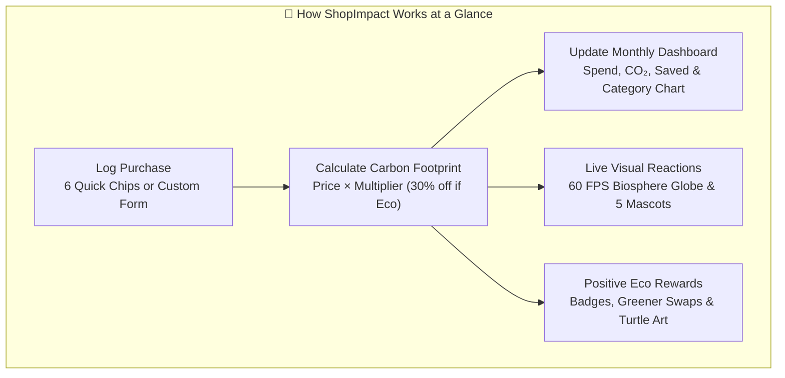
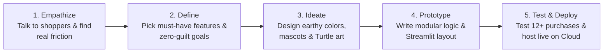
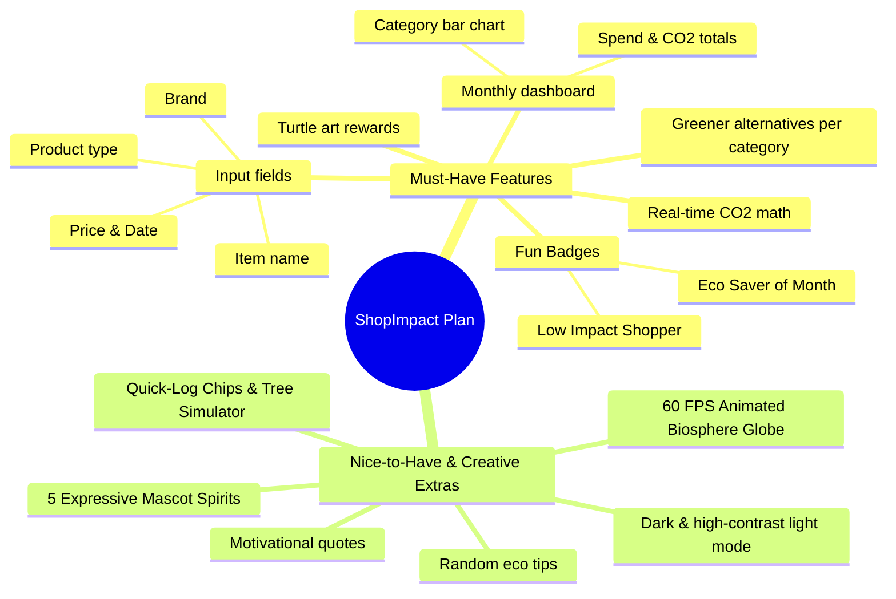
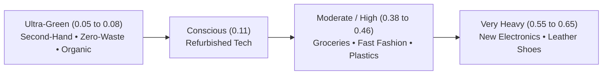
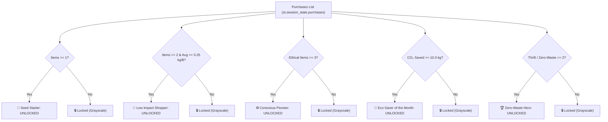
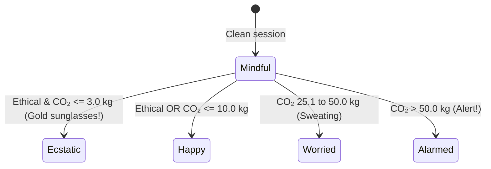
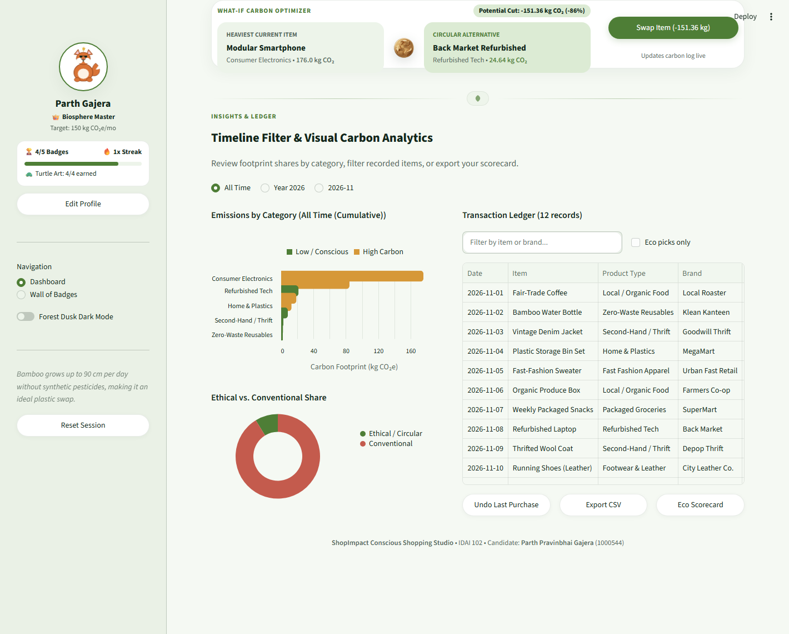
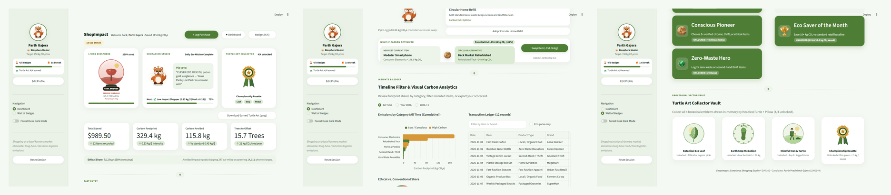

<div align="center">

# ShopImpact: Conscious Shopping Dashboard
### *See the hidden CO₂ behind every purchase and turn eco-friendly choices into a rewarding habit*

[](https://idai102-1000544-parth-parvinbhai-gajera-sa.streamlit.app/)
[](https://www.python.org/)
[](https://streamlit.io/)
[]()
[]()
[]()

</div>

> **CRS:** Artificial Intelligence  
> **Course Name:** Python Programming (`IDAI 102`)  
> **Type of Assessment:** Summative Assessment (Individual Project)  
> **Assignment Title:** Design and Deploy Interactive Python Applications for Social Good  
> **Scenario:** Scenario 1: Build ShopImpact Conscious Shopping Dashboard using Python (*ShopImpact Ltd.*)  
> **Student's Full Name:** Parth Pravinbhai Gajera  
> **Candidate Registration Number:** `1000544`  
> **School Name:** Aspee Nutan Academy / WACP International  
> **Live Web App Link:** [https://idai102-1000544-parth-parvinbhai-gajera-sa.streamlit.app/](https://idai102-1000544-parth-parvinbhai-gajera-sa.streamlit.app/)  
> **GitHub Repository:** [https://github.com/parthibcpana/IDAI102-1000544-PARTH-PARVINBHAI-GAJERA-SA](https://github.com/parthibcpana/IDAI102-1000544-PARTH-PARVINBHAI-GAJERA-SA)

---

## Quick Navigation

1. [Project Overview & Intended Learning Outcomes](#project-overview--intended-learning-outcomes)
2. [Stage 1: Understand the problem & plan our design](#stage-1-understand-the-problem--plan-our-design)
3. [Stage 2: Our Python logic & integration details](#stage-2-our-python-logic--integration-details)
4. [Stage 3: Interactive Streamlit cloud interface](#stage-3-interactive-streamlit-cloud-interface)
5. [Stage 4: Testing & creative features](#stage-4-testing--creative-features)
6. [Stage 5: Deploy & document our project](#stage-5-deploy--document-our-project)

---

## Project Overview & Intended Learning Outcomes

### What our app does (Purpose & Rationale)
When we buy clothes, gadgets, or groceries, the price tag only tells us what we pay at the counter, not what the planet pays behind the scenes. **ShopImpact** turns everyday shopping into something transparent and encouraging. Log any planned or completed purchase (product type, brand, price, and date), and the app calculates its estimated CO₂ footprint on the spot, updates a live monthly spend vs. carbon dashboard, suggests greener brands to swap to, and celebrates positive picks with unlockable badges, animated mascots, and Turtle drawings.



### Intended Learning Outcomes: What I Learned & How I Applied It

| Intended Learning Outcome | What I Learned | How I Applied It |
| :--- | :--- | :--- |
| **Design, develop, and deploy an interactive Python-based web application.** | I learned how to build a multi-screen Python web app that reacts live as users click and submit forms. | I built `app.py` with an Onboarding gateway, live Dashboard, and Wall of Badges, then deployed it online via Streamlit Cloud. |
| **Apply core Python constructs (lists, dictionaries, control structures) to solve real-world problems.** | I learned how a Python `list` and dictionaries work together to hold changing session records without a heavy database. | I stored purchases inside `st.session_state.purchases` (a Python `list`), mapped multipliers and swaps in dictionaries, and used `if/elif` rules for badges and moods. |
| **Utilize Python libraries (`datetime`, `Streamlit`) to enhance application functionality and user experience.** | I learned how plugging standard and visual Python libraries into my logic turns dry numbers into helpful visuals. | I used `datetime` for purchase dates and year/month filters, `Streamlit` for live widgets and metrics, `pandas` for charts and CSV downloads, and `Pillow` for Turtle drawings. |
| **Plan, document, test, and deploy a complete Python solution with real-world usability.** | I learned why planning a layout sketch first and testing realistic mixed inputs stops bugs before launch. | I sketched the screens early, tested 12+ cheap/expensive/eco/non-eco items, fixed Undo and cloud rendering issues, and documented every step on GitHub. |
| **Reflect on ethical considerations, user needs, and societal impact when designing technology solutions.** | I learned that shaming people over high-carbon purchases makes them close the app instead of changing habits. | I designed a zero-guilt tracker: all data stays private in local session memory with zero tracking, and heavy-carbon picks immediately show practical eco swaps instead of blame. |

---

## Stage 1: Understand the problem & plan our design



### Who will use the app?
Before designing the screens, I thought through and discussed everyday buying habits with classmates, friends, and family to see who would genuinely find this tool useful and why:

1. **Students watching their budget:** Many of us already thrift jackets, reuse water bottles, or buy second-hand laptops to save money. Using ShopImpact lets students see that saving money and cutting emissions go hand in hand, giving extra motivation to keep it up.
2. **Young shoppers making quick daily buys:** Between takeaway coffee, fast fashion sales, and groceries, people don't want to fill out a 5-minute survey for every snack. Having one-click quick chips lets them check an item's carbon cost in seconds right before buying.
3. **Eco-conscious families planning monthly buys:** Households trying to cut waste need one simple monthly scorecard showing what categories (like leather footwear or packaged groceries) create the biggest footprint, so the whole family can pick realistic swaps together.
4. **Thoughtful tech & gift buyers:** People shopping for pricier items (phones, laptops, shoes) open the Offset Simulator to compare buying brand-new vs. certified refurbished before spending hundreds of dollars.

### What pain points does it solve?
1. **Hidden impact:** Most shoppers don't know that a new pair of leather shoes or electronics carries dozens of kilograms of invisible factory CO₂.
2. **Money vs. planet disconnect:** Banking apps show how much cash left your account, not how much CO₂ that purchase added or how much carbon buying thrift saved.
3. **Guilt instead of encouragement:** Heavy climate calculators often feel preachy and technical, making casual users lose interest quickly.

### What emotions do you want to create?
**Awareness, empowerment, and fun (never guilt!).** Checking an item should feel curious and uplifting: small green swaps unlock upbeat mascot reactions, gold sunglasses, confetti balloons, and playful drawings.

### Our Feature Mind-Map (Must-Have vs. Nice-to-Have)



### Sketch of our vision
- **Design Sketch:** [Sketch of our vision (`/assets/sketch.png`)](/assets/sketch.png)
- **Screen layout planned:** Place the purchase inputs cleanly at the top, the live monthly dashboard and category chart right in the center, and badges + Turtle drawings clearly visible on the side.
- **Visual style planned:** Calm earthy tones (deep forest greens, warm beige/linen, and clean sky accents) paired with friendly animal mascots and large headers so key totals stand out immediately.

### Compulsory features planned
1. **Input fields:** Item name, product type, brand, price, date, and an ethical/circular toggle.
2. **Real-time CO₂ calculation:** Instant footprint update as soon as you log a purchase.
3. **Monthly dashboard:** Live total spend, total CO₂ impact, carbon saved, and category chart.
4. **Fun badges:** Dynamic achievements like *"Eco Saver of the Month"* and *"Low Impact Shopper"*.
5. **Greener alternatives:** Curated list of eco-friendly brands suggested for every category.
6. **Turtle graphic:** Playful leaf, footprint, or eco badge drawn automatically for positive choices.

### Optional features planned & added
- **Random eco tips** rotating with each purchase (such as liters of water saved by thrift cotton).
- **Dark mode / High-contrast light mode toggle** for comfortable reading in any lighting.
- **Motivational quotes** from environmental leaders to keep users inspired.
- **Creative bonus features:** 60 FPS animated Biosphere globe, 5 reactive companion mascots, 6 Quick-Log chips, Tree Offset Simulator, and instant Undo / CSV export.

---

## Stage 2: Our Python logic & integration details

### A Simple Algorithm We Designed
Every time a shopper logs an item, `app.py` runs one clean step-by-step sequence:

```
[Shopper logs a purchase: Quick Chip OR Custom Form]
        │
        ▼
[Calculate Impact: Price × Category Multiplier (30% off if Eco/Circular)]
        │
        ▼
[Save to Python List: Append purchase dictionary to st.session_state.purchases]
        │
        ├──> [Update Totals: Total Spend, Total CO₂, Carbon Saved & Trees]
        ├──> [Update Visuals: Shift Biosphere Globe % & Mascot Mood]
        ├──> [Check Badges: Scan purchases list -> Unlock matching milestones]
        └──> [Reward Check: Eco/Low-CO₂ pick? -> Draw HeadlessTurtle Leaf/Footprint/Badge]
```

### Data structures
- **List of purchases (`st.session_state.purchases`):** A Python **`list`** that keeps track of every logged purchase. Each element inside the list is a **`dict`** containing product type (`category`), `price`, `brand`, `date` (purchase date), `item`, `carbon_kg`, and `is_ethical`:
  ```python
  purchase = {
      "item": "Vintage Denim Jacket", "category": "Second-Hand / Thrift",
      "brand": "Goodwill Thrift", "price": 32.0, "carbon_kg": 1.12,
      "date": "2026-11-03", "is_ethical": True
  }
  ```
- **Dictionaries (`dict`) for instant lookups:**
  - `CATEGORIES`: stores the multiplier, impact tier, icon, and eco fact for each of the 9 product types.
  - `ETHICAL_ALTERNATIVES`: maps each product type to a **`list`** of greener brand swaps, benefits, and carbon cut percentages.
  - `ECO_MASCOTS`: holds the 5 companion animals and their themes.

### Impact calculation (Simple, Clear Formulas)

1. **Carbon Footprint Formula:**
   `CO₂ Footprint (kg) = Price ($) × Category Multiplier`
   *(If you check Eco-Friendly / Second-Hand: multiply by `0.70`, which gives a simple **30% discount** because reusing goods skips factory production!)*

   > **Quick Example:**  
   > - **`$130` Leather Shoes** (`0.65` high multiplier) -> `130 × 0.65` = **`84.5 kg` CO₂**  
   > - **`$32` Thrift Jacket** (`0.05` low multiplier + 30% discount) -> `32 × 0.05 × 0.70` = **`1.12 kg` CO₂**

2. **CO₂ Saved (Carbon Avoided):**
   `CO₂ Saved (kg) = (Price × 0.45 Normal Average) − Your Actual CO₂`
   *(Normal shopping averages about `0.45 kg` of CO₂ per dollar. Anytime your item emits less than that average, the difference counts as CO₂ saved! Never goes below `0`.)*

   > **Quick Example:** On that **`$32` Thrift Jacket**, normal shopping emits `32 × 0.45 = 14.40 kg`, while thrift creates only `1.12 kg`, so you saved **`13.28 kg` of CO₂**!

3. **Everyday Comparisons (`get_equivalency()`):**
   So big numbers actually make sense at a glance:
   - **Petrol Car Miles:** `CO₂ × 2.4` *(driving 1 mile burns roughly 0.4 kg CO₂)*
   - **Phone Charges:** `CO₂ × 121` *(1 kg CO₂ equals about 121 smartphone charges)*
   - **Trees to Offset:** `CO₂ ÷ 21` *(1 mature tree absorbs roughly 21 kg CO₂ in a year)*



| Product Type | Multiplier (kg CO₂ per $) | Impact Rating | Reasoning Behind Score |
| :--- | :---: | :---: | :--- |
| **Second-Hand / Thrift** | `0.05` | Minimal | Reusing extends item life with no new factory manufacturing. |
| **Zero-Waste Reusables** | `0.07` | Minimal | Durable bamboo and steel replace hundreds of single-use plastics. |
| **Local / Organic Food** | `0.08` | Low | Skips long-distance cold trucks and synthetic chemicals. |
| **Refurbished Tech** | `0.11` | Low | Avoids mining fresh rare-earth metals and building new chips. |
| **Packaged Groceries** | `0.38` | Moderate | Factory food processing and layered plastic wrapping add carbon. |
| **Fast Fashion Apparel** | `0.42` | High | Synthetic polyester production and chemical dyeing take heavy energy. |
| **Home & Plastics** | `0.46` | High | Relies on petroleum materials and high-temperature molding. |
| **Consumer Electronics** | `0.55` | High | Silicon chip manufacturing and global shipping create heavy upfront emissions. |
| **Footwear & Leather** | `0.65` | Very High | Combines livestock farming methane with intensive leather tanning. |

### Badges & messages
`evaluate_badges(purchases)` scans the purchases list after every action and turns locked grayscale cards into glowing emerald badges:



At the same time, `evaluate_feedback_for_item()` picks one of 5 mascot expressions based on your latest purchase:



- **Companion Mascots:** **Shelly 🐢** (Sea Turtle), **Pip 🦊** (Forest Fox), **Barnaby 🦉** (Eco Owl), **Bumble 🐝** (Pollinator), and **Bao 🐼** (Bamboo Panda), each with custom messages for positive and high-carbon buys.

### Suggestions
For each product type, `ETHICAL_ALTERNATIVES` stores a Python `list` of greener brands with clear CO₂ savings and a 1-click **Adopt** button right below the form:
- **Fast Fashion Apparel** -> *Patagonia Worn Wear* (`65%` cut) or *Depop / Local Thrift* (`92%` cut)
- **Consumer Electronics** -> *Back Market Refurbished* (`82%` cut) or *Fairphone Modular* (`60%` cut)
- **Footwear & Leather** -> *Allbirds / Veja* (`52%` cut) or *Will's Vegan Store* (`70%` cut)

### Integration details
We organized the codebase into small, single-job functions (`add_purchase()`, `calculate_carbon()`, `evaluate_badges()`, `get_equivalency()`, `find_top_swap_opportunity()`, `draw_vector_art()`) inside [`app.py`](app.py) and connected 5 core libraries:
- **`datetime`:** Stamps `date.today()` onto every purchase and powers *All Time / Year / Month* dashboard filtering.
- **`pandas`:** Aggregates category spend and carbon sums (`groupby("category")["carbon_kg"].sum()`) for visualizations, progress bars, and CSV downloads.
- **`altair`:** Renders interactive horizontal category bars (color-coded emerald vs. amber) and an ethical-vs.-conventional donut chart with hover tooltips.
- **`Pillow` (`ImageDraw`):** Drives our upgraded `HeadlessTurtle` vector engine (`280x280` layered botanical graphics) and PNG art exports safely on Linux cloud servers.
- **`streamlit`:** Connects forms, session lists, quick chips, top studio navigation, sortable/searchable ledger tables (`ProgressColumn`), and dual themes cleanly.

---

## Stage 3: Interactive Streamlit cloud interface

### Layout
- **Welcome & Onboarding Screen:** Opens with a custom panoramic SVG botanical horizon featuring rotating wind turbines, sunlit rolling sage hills, cottages, trees, and a conscious shopper man walking with Shelly the Sea Turtle beside a simple onboarding form.
- **Equal-Height 3-Panel Studio Grid:** An open navbar sits above a seamless CSS Grid locking **Living Biosphere**, **Companion Studio**, and **Turtle Art Collector** to identical heights on desktop and stacking cleanly on mobile screens.
- **Analytics & Ledger Section:** Displays 4 KPI metrics, avoided real-world impact, the **What-If Carbon Optimizer**, uniform **6 Quick-Log Chips**, Custom Purchase form, interactive Altair charts, and a searchable ledger.

### Interactivity
- **6 Quick-Log Chips:** Log routine purchases (*Coffee, Organic Lunch, Thrift Jacket, Refurb Tech, Fast Fashion, Leather Shoes*) in 1 click.
- **What-If Carbon Optimizer:** Detects your heaviest conventional item, previews the exact kg CO2 drop of a circular swap, and swaps it in 1 click.
- **Searchable Ledger & Exports:** Live keyword search, *Eco picks only* toggle, *All Time / Year / Month* filter radio, **Tree Offset Simulator**, **Undo Last Purchase**, guarded Reset dialog, **Export CSV**, and **Eco Scorecard (`.md`)** download.

### Visual hierarchy
Generous whitespace, soft rounded `20px` surfaces with hairline `1px` borders, pill action buttons, and calm typography keep numbers and eco actions crystal clear without boxy clutter.

### Color palette
Built natively with Streamlit Light theming (`.streamlit/config.toml`) in flat, natural botanical tones inspired by morning sage landscapes: **Daytime Botanical Light Mode** (`#F5F9F3` meadow cream backdrop, `#FFFFFF` cards, `#13261B` deep pine ink, `#4E7E36` olive-moss primary actions, `#D69838` birch ochre, `#C45B4D` muted terracotta) plus a smooth **Forest Dusk Dark Mode** toggle (`#131C17` matte slate backdrop).

### Live App Screenshots

<div align="center">

<p><em>Screen 1 (Welcome & Onboarding): Custom SVG landscape with rotating wind turbines, sunlit trees, valley homes, and walking shopper man with pure-math Turtle companion.</em></p>
</div>

<div align="center">

<p><em>Screen 2A (Botanical Light Studio): Equal-height 3-card Hero Studio (Biosphere, Math-Turtle Companion & Rosette), KPI cards, and uniform Quick-Log pills.</em></p>
</div>

<div align="center">

<p><em>Screen 2B (Forest Dusk Dark Mode): Matte deep-pine palette with adaptive contrast across inputs, dropdowns, calendars, alerts, toasts, and charts.</em></p>
</div>

<div align="center">

<p><em>Screen 2C (Interactive Analytics & Optimizer): What-If Carbon Optimizer 1-click swap banner, olive/ochre Altair charts, and searchable Progress Ledger.</em></p>
</div>

<div align="center">

<p><em>Screen 3 (Wall of Badges & Procedural Turtle Art Vault): 4 of 5 milestone badges unlocked above the 4-piece pure-math HeadlessTurtle Vault (Leaf, Step, Mindful Man & Turtle, Championship Rosette).</em></p>
</div>

---

## Stage 4: Testing & creative features

### Testing with 10 to 15 purchases
As suggested in the brief, I tested ShopImpact by acting as a first-time user and entering **12 mixed purchases** spanning expensive, cheap, eco, and non-eco items (plus adopting a greener swap as item #13, running the What-If Optimizer drop from `523.34 kg` to `215.89 kg`, toggling Light and Forest Dusk themes, and testing **Undo** back to 12):

| Test Group | Sample Purchases Entered (12 Total) | Prices Tested | Observed Result |
| :--- | :--- | :---: | :--- |
| **Cheap Eco** | Fair-Trade Coffee, Glass Pantry Jar Pack, Bamboo Water Bottle | `$4.50 to $24` | Totals updated live (`0.25 to 1.18 kg`); Pip put on gold sunglasses; Turtle drew Gold Rosette & Leaf. |
| **Mid-Range Eco** | Vintage Denim Jacket, Organic Produce Box, Thrifted Wool Coat | `$32 to $48` | Applied 30% eco discount; unlocked *Seed Starter*, *Conscious Pioneer*, and *Zero-Waste Hero*. |
| **Expensive Eco** | Refurbished Laptop (`Back Market`) | `$280` | Logged just `21.56 kg` CO2 (vs `154 kg` new); raised Carbon Saved past `100 kg` and unlocked *Eco Saver*. |
| **Non-Eco (Cheap & Expensive)** | Plastic Bins, Fast-Fashion Sweater, Packaged Snacks, Leather Shoes (`$130`), Smartphone (`$320`) | `$22 to $320` | Intensity rose to `0.33 kg/$`; Biosphere shifted to terracotta Overload and *Low Impact Shopper* stayed locked (`> 0.25 kg/$`). |

**Verification checks from testing:**
- **Do totals update immediately?** Yes. All 4 KPIs (`$989.50` spend, `329.4 kg` CO2, `115.8 kg` avoided, `15.7 Trees`), Altair charts, and the ledger update right away on every submit and swap.
- **Are badges awarded correctly?** Yes. All 4 earned badges unlocked at exact thresholds while *Low Impact Shopper* stayed locked until carbon intensity dropped below `0.25 kg/$`.
- **Does Turtle drawing appear at the right time?** Yes. Eco Leaf, Earth Step Medallion, Mindful Man & Turtle, and Championship Rosette unlock cleanly and export as `.png` files.

### Proof of tests (3 sample screenshots collage)

<div align="center">

<p><em>3-Panel Test Proof Collage: (1) Botanical Light Hero, Biosphere & Rosette reward; (2) 12-purchase mix showing What-If Optimizer, Altair charts & searchable ledger; (3) Wall of Badges & 4-piece Turtle Art Vault.</em></p>
</div>

### Feedback & refinements we made
After testing on desktop and `412px` mobile screens, we spotted 5 friction points and refined every one:
1. **Harsh dark boxes & heavy gradients:** Replaced dark neon rectangles and muddy gradients with a light, breathable flat botanical palette inspired by natural greens, soft shadows, and equal-height CSS Grid hero cards.
2. **Theme text mismatches:** Added `.streamlit/config.toml` (`base = "light"`) and unified Light/Dark CSS tokens so inputs, buttons, metric deltas, and charts adapt text contrast automatically.
3. **Mobile responsiveness & alignment:** Set sidebar state to `auto`, added mobile `@media (max-width: 920px)` single-column stacking, and fixed Quick-Log chip heights so all 6 buttons align flat.
4. **Actionable swap discovery:** Added the **What-If Carbon Optimizer** above the ledger alongside search/eco-only filtering and **Eco Scorecard (`.md`)** downloads.
5. **Cloud Turtle & Welcome artwork:** Built our base64 panoramic SVG horizon (animated wind turbines, sunlit hillside, walking shopper man & turtle) and 4-piece Pillow `HeadlessTurtle` vault without desktop `tkinter`.

### Creative features added
- **Panoramic Ecovista SVG Welcome Horizon:** Custom animated vector scene with rotating wind turbines, sunlit valley homes, golden conifers, and a shopper walking with Shelly the Turtle:
  ```mermaid
  flowchart LR
      P["Monthly Budget %"] --> S1["<= 50%: Pristine Biosphere (Olive Moss)"]
      P --> S2["51% to 85%: Balanced Ecosystem (Sage)"]
      P --> S3["86% to 100%: Budget Warning (Birch Gold)"]
      P --> S4["> 100%: Carbon Overload (Terracotta)"]
  ```

- **Cloud-Safe 4-Piece Headless Turtle Art Vault (`HeadlessTurtle`):** Procedurally draws **Botanical Eco Leaf**, **Earth Step Medallion**, **Mindful Man & Turtle**, and **Championship Gold Rosette** on `280x280` Pillow canvases with `.png` download:
  ```mermaid
  flowchart LR
      T["Turtle State (x, y, heading)"] --> M["Trigonometric Steps<br>forward / leaf / walker / rosette"]
      M --> IMG["Pillow RGBA 280x280 Canvas"]
      IMG --> ART["Leaf • Step • Man & Turtle • Rosette"]
  ```

- **Eco Streaks, Daily Missions & What-If Carbon Optimizer:** Live ethical streak counter, daily mission tracker, and 1-click swap of your heaviest conventional purchase.
- **Tree Offset Simulator & Downloadable Eco Scorecard:** Interactive `$5 to $500` pre-purchase impact slider alongside downloadable `.csv` transaction logs and `.md` Eco Scorecard summaries.

---

## Stage 5: Deploy & document our project

### Files uploaded to GitHub
- `app.py` (Clean, refactored Python & Streamlit studio application)
- `.streamlit/config.toml` (Native Botanical Light base theme configuration)
- `requirements.txt` (Pinned packages: `streamlit>=1.35.0`, `pandas>=2.0.0`, `pillow>=10.0.0`, `altair>=5.0.0`)
- `README.md` (Full project guide, logic breakdown, testing proof, and live link)
- `assets/` (Design wireframe sketch at `/assets/sketch.png` and verified app screenshots inside `assets/screenshots/`)

### Deployment instructions

**Run locally:**
```bash
git clone https://github.com/parthibcpana/IDAI102-1000544-PARTH-PARVINBHAI-GAJERA-SA.git
cd IDAI102-1000544-PARTH-PARVINBHAI-GAJERA-SA
pip install -r requirements.txt
streamlit run app.py
```

**Deploy to Streamlit Cloud:**
1. Push `app.py`, `requirements.txt`, `README.md`, and `assets/` to our GitHub repository.
2. Open [share.streamlit.io](https://share.streamlit.io/) and click **"Deploy an app"** (*"Create app"*).
3. Connect GitHub and select `parthibcpana/IDAI102-1000544-PARTH-PARVINBHAI-GAJERA-SA` (`main` branch, main file `app.py`).
4. Click **Deploy** to publish the live web app.

### Live web app link
**Live Web App:** [https://idai102-1000544-parth-parvinbhai-gajera-sa.streamlit.app/](https://idai102-1000544-parth-parvinbhai-gajera-sa.streamlit.app/)

---

**Parth Pravinbhai Gajera** (Candidate Registration No: `1000544`) | `IDAI 102: Python Programming` | Artificial Intelligence | Aspee Nutan Academy / WACP International
