<p align="center">
  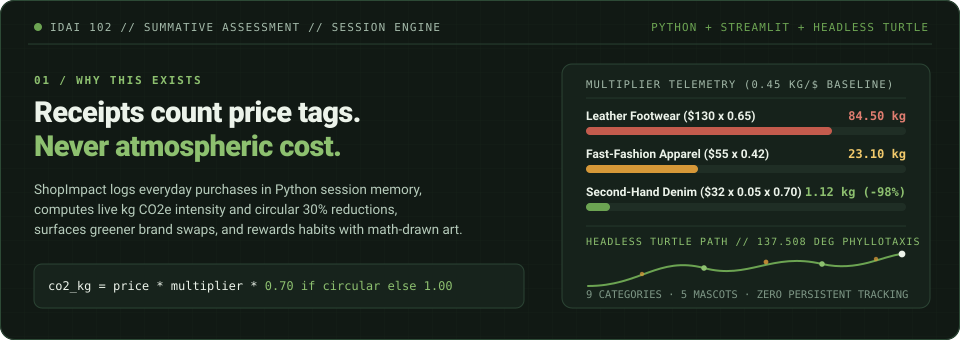
</p>

<div align="center">

# ShopImpact: Conscious Shopping Dashboard
### *See the hidden CO₂ behind every purchase and turn low-waste choices into a measurable habit*

[](https://idai102-1000544-parth-parvinbhai-gajera-sa.streamlit.app/)
[](https://www.python.org/)
[](https://streamlit.io/)
[](.streamlit/config.toml)

</div>

> **CRS:** Artificial Intelligence  
> **Course Name:** Python Programming (`IDAI 102`)  
> **Type of Assessment:** Summative Assessment (Individual Project)  
> **Assignment Title:** Design and Deploy Interactive Python Applications for Social Good  
> **Scenario:** Scenario 1: Build ShopImpact Conscious Shopping Dashboard using Python (*ShopImpact Ltd.*)  
> **Student's Full Name:** Parth Pravinbhai Gajera  
> **Candidate Registration Number:** `1000544`  
> **School Name:** Aspee Nutan Academy / WACP International  
> **Live Web App Link:** [https://idai102-1000544-parth-parvinbhai-gajera-sa.streamlit.app/](https://idai102-1000544-parth-parvinbhai-gajera-sa.streamlit.app/)  
> **GitHub Repository:** [https://github.com/parthibcpana/IDAI102-1000544-PARTH-PARVINBHAI-GAJERA-SA](https://github.com/parthibcpana/IDAI102-1000544-PARTH-PARVINBHAI-GAJERA-SA)

<p align="center"></p>

## Quick Navigation

1. [Project Overview & Intended Learning Outcomes](#project-overview--intended-learning-outcomes)
2. [Stage 1: Understand the problem & plan our design](#stage-1-understand-the-problem--plan-our-design)
3. [Stage 2: Our Python logic & integration details](#stage-2-our-python-logic--integration-details)
4. [Stage 3: Interactive Streamlit cloud interface](#stage-3-interactive-streamlit-cloud-interface)
5. [Stage 4: Testing & creative features](#stage-4-testing--creative-features)
6. [Stage 5: Deploy & document our project](#stage-5-deploy--document-our-project)

<p align="center"></p>

## Project Overview & Intended Learning Outcomes

### What our app does (Purpose & Rationale)
When we buy clothes, gadgets, or groceries, the price tag only tells us what we pay at the counter, not what the planet pays behind the scenes. **ShopImpact** makes everyday buying footprints visible without guilt. Log any planned or completed purchase (product type, brand, price, and date) to calculate its estimated CO₂e immediately, update a live monthly spend vs. carbon ledger, compare greener brand swaps, and collect pure-math Turtle drawings and milestone badges.

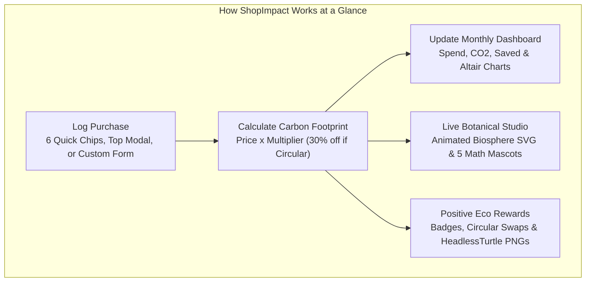

### Intended Learning Outcomes: What I Learned & How I Applied It

| Intended Learning Outcome | What I Learned | How I Applied It |
| :--- | :--- | :--- |
| **Design, develop, and deploy an interactive Python-based web application.** | I learned how to structure a multi-screen Python web app that reacts cleanly as users submit forms, toggle themes, and inspect live charts. | Built `app.py` with an Onboarding gateway, Command Studio (`+ Log Purchase` modal + live simulator fragment), and Wall of Badges hosted on Streamlit Cloud. |
| **Apply core Python constructs (lists, dictionaries, control structures) to solve real-world problems.** | I learned how a Python `list` of dictionaries keeps fast, mutable session records without needing external SQL setup. | Stored active buys in `st.session_state.purchases` (`list[dict]`), mapped multipliers and brand swaps in dictionaries, and drove badges and moods with clean `if/elif` functions. |
| **Utilize Python libraries (`datetime`, `Streamlit`) to enhance application functionality and user experience.** | I learned how combining standard and data libraries turns plain numeric logs into fast visual feedback. | Used `datetime` for purchase stamps and period filtering, `Streamlit` (`@st.cache_data`, `@st.dialog`, `@st.fragment`) for smooth speed, `Altair`/`pandas` for charts and exports, and `Pillow` for `HeadlessTurtle` PNGs. |
| **Plan, document, test, and deploy a complete Python solution with real-world usability.** | I learned why sketching screen hierarchy first and stress-testing mixed purchases prevents layout bugs and edge-case errors. | Mapped a 3-screen sketch early, verified 12+ varied purchases live, tuned dark/light popover contrast and WebSocket image caching, and documented every stage cleanly. |
| **Reflect on ethical considerations, user needs, and societal impact when designing technology solutions.** | I learned that preachy or guilt-heavy interfaces push people away instead of building sustainable habits. | Kept all records strictly private inside local session memory with zero telemetry, and paired heavy-carbon purchases with constructive 1-click circular swaps. |

<p align="center"></p>

## Stage 1: Understand the problem & plan our design

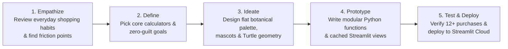

### Who will use the app?
Before designing the screens, I talked through everyday buying habits with classmates, friends, and family to understand who would actually keep using this tool:

1. **Students watching their budget:** Many of us already thrift denim, reuse bottles, or pick refurbished laptops to save money. Seeing exact kg CO₂e savings next to dollar savings reinforces that frugal and sustainable choices align.
2. **Daily convenience shoppers:** Between morning coffee, quick snacks, and online apparel drops, nobody fills out a 5-minute survey for a `$4.50` drink. One-tap Quick-Log chips record routine items immediately.
3. **Households reviewing monthly spending:** Families cutting household waste need one clear monthly view showing which categories (such as packaged groceries or leather footwear) drive most emissions so they can swap smartly together.
4. **Thoughtful tech and gift buyers:** Shoppers weighing big-ticket buys (phones, laptops, shoes) open the live Pre-Purchase Offset Simulator to compare brand-new vs. refurbished impact before paying.

### What pain points does it solve?
1. **Hidden atmospheric cost:** Receipts display price and tax, never the manufacturing carbon behind leather shoes or electronics.
2. **Money vs. planet disconnect:** Banking summaries track cash spent, not how much CO₂ an item emitted or how much carbon buying circular avoided.
3. **Calculator fatigue and guilt:** Overly dense, scolding climate tools make casual shoppers close the tab quickly.

### What emotions do you want to create?
**Curiosity, clarity, and encouragement (never guilt).** Logging an eco pick unlocks upbeat mascot reactions, gold sunglasses, and custom mathematical artwork, while heavy items calmly offer lower-carbon alternatives.

### Our Feature Mind-Map (Must-Have vs. Nice-to-Have)

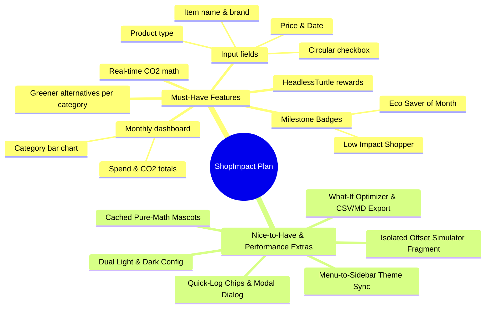

### Sketch of our vision
To map the interface hierarchy before building in Streamlit, I sketched the screen layout for onboarding, the live studio dashboard, and rewards:

<div align="center">
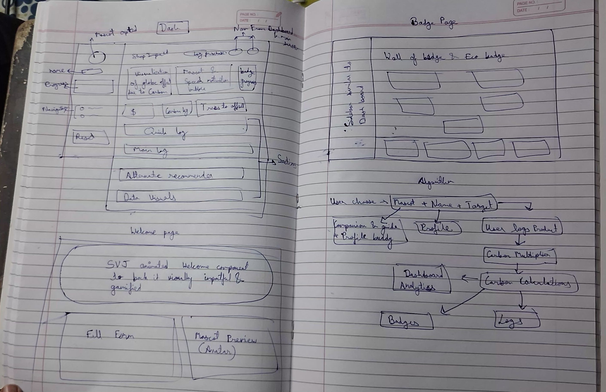
<p><em>Initial UI Sketch (`assets/sketch.png`): Planned placement of the onboarding horizon, 3-panel hero studio, KPI cards, and badge vault.</em></p>
</div>

- **Screen layout planned:** Keep a persistent `+ Log Purchase` button and 3-panel hero studio at the top, surface live KPIs and Quick-Log chips right underneath, and place interactive Altair charts beside a searchable Transaction Ledger.
- **Visual style planned:** Calm botanical cream and sage tones (`#F5F9F3`, `#4E7E36`) paired with clear typography and procedural mathematical visuals rather than cluttered dashboard chrome.

### Compulsory features planned
1. **Input fields:** Item description, category selector, optional brand, price, purchase date, and circular/ethical toggle.
2. **Real-time CO₂ calculation:** Instant footprint and avoided-carbon updates on every entry.
3. **Monthly dashboard:** Spend total, net CO₂ footprint, avoided emissions, tree equivalent, and category breakdowns.
4. **Milestone badges:** Dynamic goals including *Eco Saver of the Month* and *Low Impact Shopper*.
5. **Greener alternatives:** Actionable category swaps with percentage reductions and 1-click adoption.
6. **Turtle graphics:** Pure-math `HeadlessTurtle` emblems drawn automatically for mindful choices.

### Optional features planned & added
- **Rotating eco tips** tied to session count inside custom logging views.
- **Native Light & Forest Dusk Dark theming** with bidirectional sync between the sidebar toggle and Streamlit's top-right three-dots menu (`System / Light / Dark`).
- **Cached performance studio:** Pre-Purchase Carbon Simulator running inside an isolated `@st.fragment`, cached 3D icons (`112x112` @2x Retina), `@st.cache_data` mascot SVGs, What-If Carbon Optimizer, instant Undo, and `.csv` / `.md` scorecard exports.

<p align="center"></p>

## Stage 2: Our Python logic & integration details

### A Simple Algorithm We Designed
Every log, swap, or chip click runs through one deterministic Python sequence inside `app.py`:

<p align="center">
  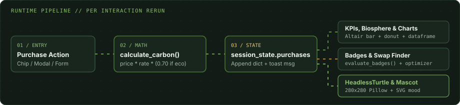
</p>

### Data structures
- **Session purchases (`st.session_state.purchases`):** A Python **`list`** storing one **`dict`** per logged item (`id`, `item`, `category`, `brand`, `price`, `carbon_kg`, `date`, `is_ethical`):
  ```python
  purchase = {
      "id": 1, "item": "Vintage Denim Jacket", "category": "Second-Hand / Thrift",
      "brand": "Goodwill Thrift", "price": 32.0, "carbon_kg": 1.12,
      "date": "2026-11-03", "is_ethical": True
  }
  ```
- **Lookup dictionaries (`dict`):**
  - `CATEGORIES`: holds the emission multiplier, impact tier label, and domain explanation for all 9 product categories.
  - `ETHICAL_ALTERNATIVES`: maps each category to verified circular swaps and percentage cuts.
  - `ECO_MASCOTS`: stores the 5 companion animals (Shelly, Pip, Barnaby, Bumble, Bao) and themes.

### Impact calculation (Simple, Clear Formulas)

1. **Carbon Footprint Formula:**
   `CO₂ Footprint (kg) = Price ($) × Category Multiplier`
   *(If Circular / Ethical is checked: multiply by `0.70` for a **30% reduction** because circular goods avoid virgin factory manufacturing.)*

   > **Quick Example:**  
   > - **`$130` Leather Shoes** (`0.65` multiplier) -> `130 × 0.65` = **`84.50 kg` CO₂**  
   > - **`$32` Thrift Jacket** (`0.05` multiplier × `0.70` discount) -> `32 × 0.05 × 0.70` = **`1.12 kg` CO₂**

2. **CO₂ Saved (Carbon Avoided):**
   `CO₂ Saved (kg) = (Price × 0.45 Baseline Average) - Actual CO₂`
   *(Standard retail averages around `0.45 kg` CO₂ per dollar. Whenever an item emits less than that baseline, the difference is banked as CO₂ saved, clamped at `0.0` minimum.)*

   > **Quick Example:** On the **`$32` Thrift Jacket**, baseline retail emits `32 × 0.45 = 14.40 kg`, while thrift emits `1.12 kg`, avoiding **`13.28 kg` CO₂**.

3. **Everyday Comparisons (`get_equivalency()`):**
   - **Petrol Car Miles:** `CO₂ × 2.4`
   - **Phone Charges:** `CO₂ × 121`
   - **Tree-Months Needed to Offset:** `(CO₂ ÷ 21.0) × 12` *(1 mature tree absorbs ~21 kg CO₂/year)*

<p align="center">
  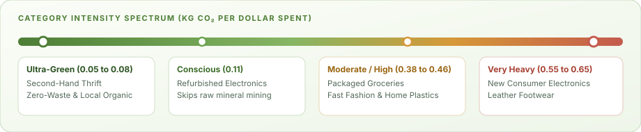
</p>

| Product Type | Multiplier (kg CO₂ per $) | Impact Rating | Reasoning Behind Score |
| :--- | :---: | :---: | :--- |
| **Second-Hand / Thrift** | `0.05` | Minimal | Reusing extends garment/item life without new manufacturing. |
| **Zero-Waste Reusables** | `0.07` | Minimal | Durable bamboo and steel displace single-use plastics repeatedly. |
| **Local / Organic Food** | `0.08` | Low | Eliminates long-haul refrigerated freight and synthetic chemicals. |
| **Refurbished Tech** | `0.11` | Low | Avoids rare-earth mineral mining and fresh semiconductor fab emissions. |
| **Packaged Groceries** | `0.38` | Moderate | Industrial processing and layered plastic packaging raise footprint. |
| **Fast Fashion Apparel** | `0.42` | High | Synthetic polyester spinning and chemical dyeing consume heavy energy. |
| **Home & Plastics** | `0.46` | High | Petrochemical feedstocks and high-heat molding drive emissions. |
| **Consumer Electronics** | `0.55` | High | Wafer fabrication and global hardware logistics carry high upfront CO₂. |
| **Footwear & Leather** | `0.65` | Very High | Combines livestock emissions with intensive leather tanning. |

### Badges & messages
`evaluate_badges(purchases)` scans the active session list after every action and updates badge states:

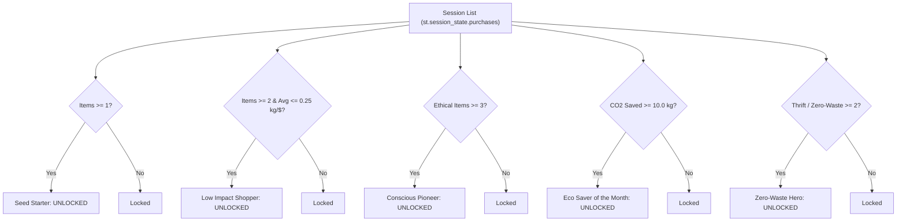

Meanwhile, `evaluate_feedback_for_item()` picks one of 5 mascot reactions based on the latest item's CO₂ footprint:

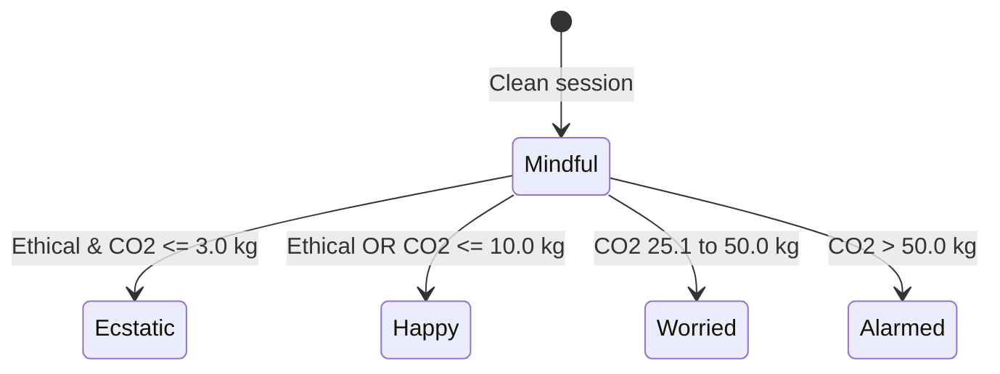

- **Companion Mascots:** **Shelly** (Sea Turtle), **Pip** (Forest Fox), **Barnaby** (Eco Owl), **Bumble** (Pollinator), and **Bao** (Bamboo Panda), rendered cleanly via pure-math `HeadlessTurtle` curves (superellipses, cubic Beziers, hex scutes, and polar trigonometry).

### Suggestions
For each category, `ETHICAL_ALTERNATIVES` suggests greener brands with expected CO₂ reductions and a 1-click **Adopt** action:
- **Fast Fashion Apparel** -> *Patagonia Worn Wear* (`65%` cut) or *Depop / Local Thrift* (`92%` cut)
- **Consumer Electronics** -> *Back Market Refurbished* (`82%` cut) or *Fairphone Modular* (`60%` cut)
- **Footwear & Leather** -> *Allbirds / Veja* (`52%` cut) or *Will's Vegan Store* (`70%` cut)

### Integration details
The logic lives inside clean, single-job functions inside [`app.py`](app.py) (`add_purchase()`, `calculate_carbon()`, `evaluate_badges()`, `get_equivalency()`, `find_top_swap_opportunity()`, `_render_turtle_art_png_cached()`) backed by 5 core Python libraries:
- **`datetime`:** Stamps `date.today()` onto records and drives *All Time / Year / Month* filters.
- **`pandas`:** Aggregates spend and CO₂ totals for charts and CSV exports.
- **`altair`:** Renders horizontal category bars (olive green vs. ochre amber) and an ethical-vs.-conventional donut chart with tooltips.
- **`Pillow` (`ImageDraw`):** Drives `HeadlessTurtle` `280x280` raster exports and `@2x` Retina icon thumbnail caching (`112x112`) safely on headless Linux cloud servers.
- **`streamlit`:** Connects `@st.dialog` quick logging, `@st.fragment` offset simulation, `@st.cache_data` CSS/SVG pipelines, ProgressColumn tables, and synced dual themes.

<p align="center"></p>

## Stage 3: Interactive Streamlit cloud interface

### Layout
- **Welcome & Onboarding Screen:** Opens with a custom animated botanical SVG horizon featuring turning wind turbines, rolling hills, valley cottages, and a walker with Shelly the Turtle beside the onboarding form.
- **Equal-Height 3-Panel Studio Grid:** An open top action bar (`+ Log Purchase`, `Dashboard`, `Badges`) sits above a CSS Grid locking **Living Biosphere**, **Companion Studio**, and **Turtle Art Collector** cleanly across desktop and stacking smoothly under `920px` on mobile.
- **Analytics & Ledger Studio:** Pairs 4 KPI cards, avoided real-world equivalents, the **What-If Carbon Optimizer**, 6 aligned Quick-Log tiles, Custom Form, Altair charts, and a searchable Transaction Ledger.

### Interactivity
- **Quick-Log Chips & First-View `+ Log Purchase` Modal:** Record routine items in 1 click or open the top dialog from anywhere without scrolling.
- **What-If Carbon Optimizer:** Detects your heaviest conventional item, previews the CO₂ drop of swapping to thrift/refurbished/zero-waste, and swaps it in 1 click.
- **Fast Pre-Purchase Simulator (`@st.fragment`):** Adjust spend sliders in real time with zero full-page flicker.
- **Ledger Controls & Exports:** Live item/brand search, *Eco picks only* toggle, timeline radio filter, **Undo Last Purchase**, guarded Reset confirmation, **Export CSV**, and **Eco Scorecard (`.md`)**.

### Visual hierarchy
Generous breathing room, `20px` rounded surfaces with hairline `1px` borders, pill action buttons, and high-contrast alerts and toasts keep totals readable without noisy boxes.

### Color palette
Dual native Streamlit themes configured inside [`.streamlit/config.toml`](.streamlit/config.toml):
- **Ecovista Botanical Light (`[theme.light]`):** `#F5F9F3` meadow cream backdrop, `#FFFFFF` elevated cards, `#13261B` deep pine ink, `#4E7E36` olive-moss primary buttons, `#D69838` ochre, `#C45B4D` terracotta.
- **Forest Dusk Dark (`[theme.dark]`):** `#131C17` matte forest-slate backdrop, `#1C2921` card surfaces, `#ECF3EA` crisp pale ink, `#6CA452` sage accent, synced automatically between the sidebar toggle and Streamlit's `⋮` (`System / Light / Dark`) menu.

### App Showcase Gallery
<p align="center">
  <a href="https://idai102-1000544-parth-parvinbhai-gajera-sa.streamlit.app/">
    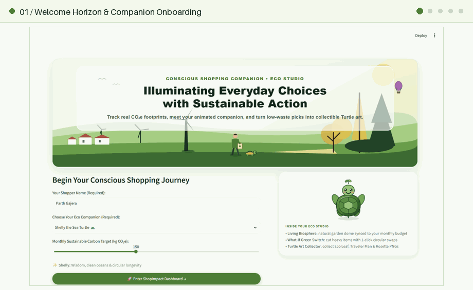
  </a><br/>
  <em>Animated Walkthrough (5 Screens): Onboarding Horizon -> Botanical Light Studio -> Forest Dusk Dark Mode -> Analytics &amp; Ledger -> Badges &amp; Turtle Vault.</em>
</p>

<table>
  <tr>
    <td width="50%" align="center">
      <a href="assets/screenshots/onboarding_v3.png">
        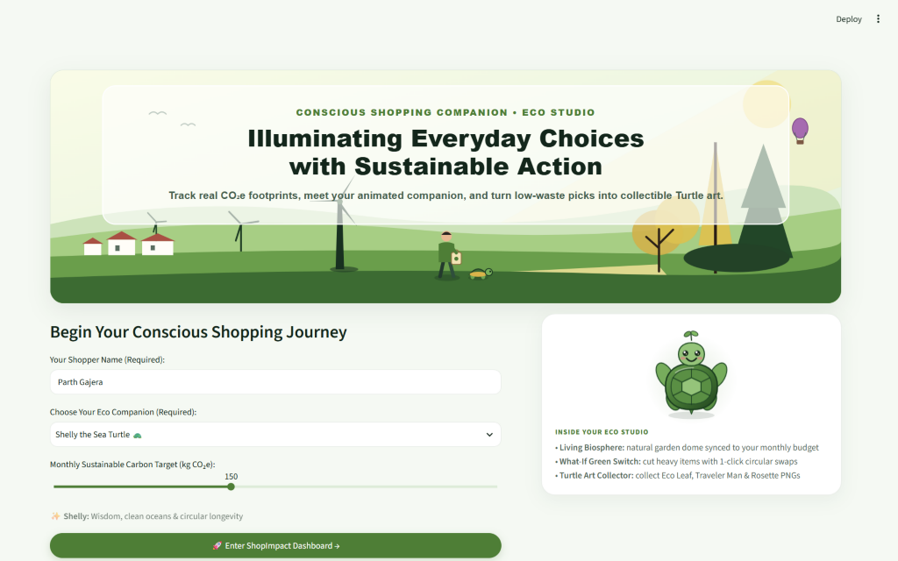
      </a><br/>
      <strong>1. Welcome &amp; Onboarding</strong><br/>
      <sub>Animated SVG landscape, companion selector &amp; budget target (click to zoom)</sub>
    </td>
    <td width="50%" align="center">
      <a href="assets/screenshots/dashboard_v5.png">
        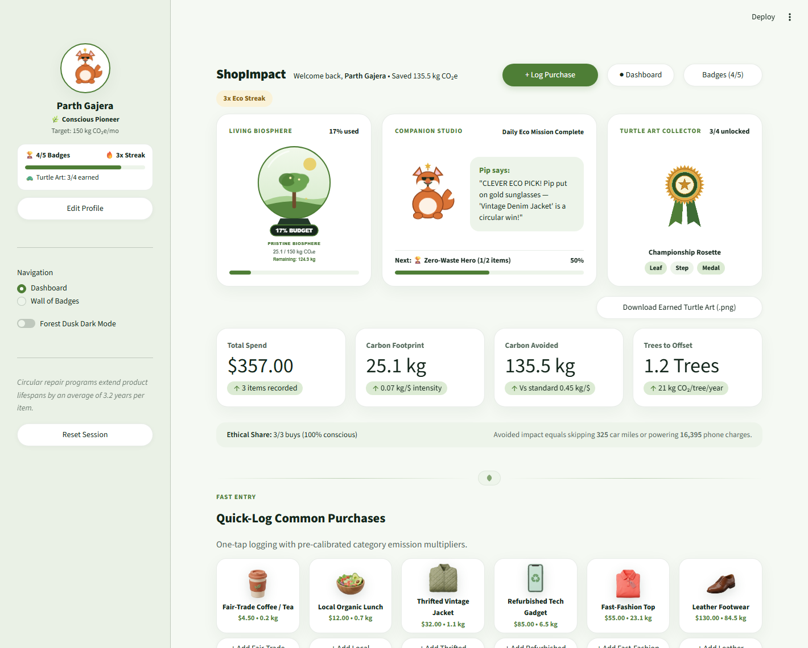
      </a><br/>
      <strong>2. Botanical Light Studio</strong><br/>
      <sub>Equal-height 3-card hero, KPI metrics &amp; 3D Quick-Log chips (click to zoom)</sub>
    </td>
  </tr>
  <tr>
    <td width="50%" align="center">
      <a href="assets/screenshots/dashboard_dark_v3.png">
        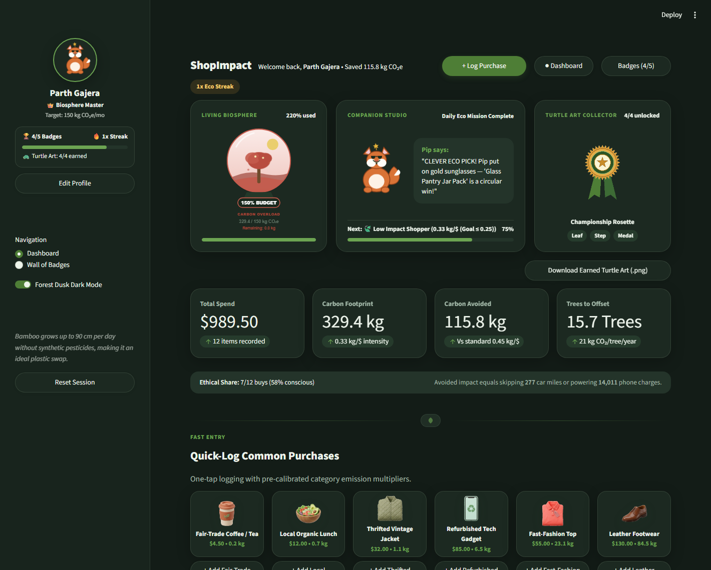
      </a><br/>
      <strong>3. Forest Dusk Dark Mode</strong><br/>
      <sub>Adaptive dark contrast across menus, calendars, alerts &amp; toasts (click to zoom)</sub>
    </td>
    <td width="50%" align="center">
      <a href="assets/screenshots/wall_of_badges_v4.png">
        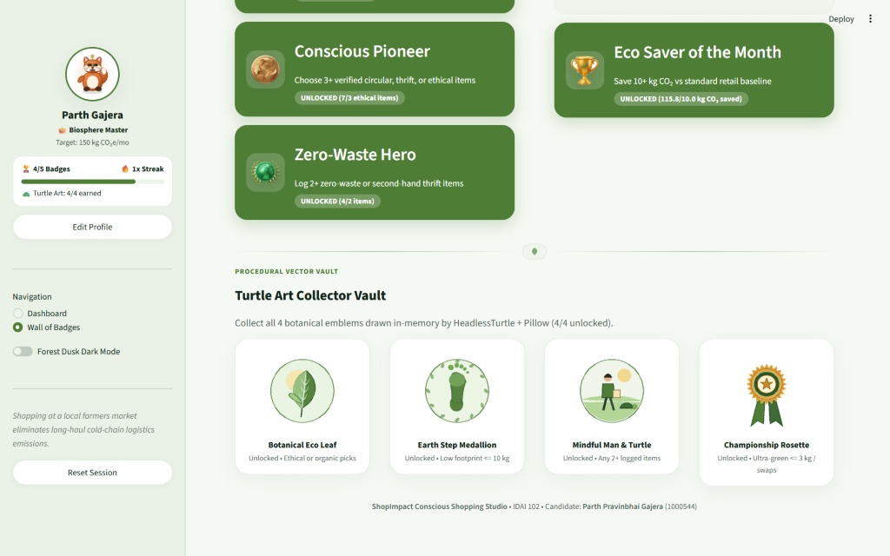
      </a><br/>
      <strong>4. Wall of Badges &amp; Turtle Vault</strong><br/>
      <sub>Milestone cards above the 4-piece HeadlessTurtle gallery (click to zoom)</sub>
    </td>
  </tr>
</table>

<p align="center"></p>

## Stage 4: Testing & creative features

### Testing with 10 to 15 purchases
As suggested in the brief, I tested ShopImpact by acting as a first-time user and entering **12 mixed purchases** spanning cheap, expensive, circular, and conventional items (plus adopting a swap as item #13, testing the What-If Optimizer drop from `523.34 kg` to `215.89 kg`, toggling Light and Dark modes from both the sidebar and `⋮` menu, and verifying **Undo**):

| Test Group | Sample Purchases Entered (12 Total) | Prices Tested | Observed Result |
| :--- | :--- | :---: | :--- |
| **Cheap Eco** | Fair-Trade Coffee, Glass Pantry Jar Pack, Bamboo Water Bottle | `$4.50 to $24` | Totals updated cleanly (`0.25 to 1.18 kg`); Pip put on gold sunglasses; Turtle rendered Gold Rosette & Eco Leaf. |
| **Mid-Range Eco** | Vintage Denim Jacket, Organic Produce Box, Thrifted Wool Coat | `$32 to $48` | Applied 30% circular discount; unlocked *Seed Starter*, *Conscious Pioneer*, and *Zero-Waste Hero*. |
| **Expensive Eco** | Refurbished Laptop (`Back Market`) | `$280` | Logged `21.56 kg` CO₂ (vs `154 kg` new), pushing avoided CO₂ past `100 kg` and unlocking *Eco Saver*. |
| **Non-Eco (Cheap & Expensive)** | Plastic Bins, Fast-Fashion Sweater, Packaged Snacks, Leather Shoes (`$130`), Smartphone (`$320`) | `$22 to $320` | Intensity rose to `0.33 kg/$`; Biosphere turned terracotta Overload and *Low Impact Shopper* stayed locked (`> 0.25 kg/$`). |

**Verification checks from testing:**
- **Do totals update immediately?** Yes. All 4 KPIs (`$989.50` spend, `329.4 kg` CO₂, `115.8 kg` avoided, `15.7 Trees`), Altair charts, and the ledger update immediately.
- **Are badges awarded correctly?** Yes. Earned badges unlock at exact thresholds while *Low Impact Shopper* stays locked until carbon intensity falls below `0.25 kg/$`.
- **Does Turtle drawing appear at the right time?** Yes. Eco Leaf, Earth Step Medallion, Mindful Man & Turtle, and Championship Rosette unlock and export cleanly as `.png` files.

### Proof of tests (Clickable Verification Captures)

<table>
  <tr>
    <td width="50%" align="center">
      <a href="assets/screenshots/analytics_v3.png">
        
      </a><br/>
      <strong>12-Purchase Mix, Optimizer &amp; Ledger</strong><br/>
      <sub>Altair category/share charts, 1-click circular swap &amp; CSV/MD ledger (click to zoom)</sub>
    </td>
    <td width="50%" align="center">
      <a href="assets/screenshots/wall_of_badges_v4.png">
        
      </a><br/>
      <strong>Verified Badges &amp; HeadlessTurtle Vault</strong><br/>
      <sub>4 of 5 milestones unlocked at thresholds with downloadable `.png` art (click to zoom)</sub>
    </td>
  </tr>
</table>

### Feedback & refinements we made
Testing on desktop browsers, Streamlit Community Cloud, and narrow mobile viewports uncovered 6 concrete issues we resolved:
1. **Heavy dark boxes & harsh contrast:** Replaced boxy dark panels with a soft flat botanical palette and responsive equal-height CSS Grid hero cards.
2. **Dark/Light popover & alert contrast bugs:** Explicitly styled React Aria/BaseWeb select dropdowns, calendars, alerts (`Reset Session` warning and empty-period info), and toast notifications so dark mode never leaves white backgrounds under light text.
3. **Top three-dots (`⋮`) menu theme sync:** Configured dual `[theme.light]` & `[theme.dark]` sections in `.streamlit/config.toml`, isolated `⋮` popover typography from app-body ink rules, and synced theme switches bidirectionally between `⋮` (`System / Light / Dark`) and the sidebar toggle (even inside Streamlit Cloud's iframe).
4. **Rerun latency & WebSocket asset weight:** Cached SVG generators (`render_animated_avatar_svg`, `render_animated_biosphere_svg`), pre-encoded `HeadlessTurtle` PNG URIs, cached tokenized CSS, downsampled 3D icons to `@2x` (`112x112`), and isolated the Offset Simulator inside `@st.fragment`.
5. **Actionable swap discovery:** Added the **What-If Carbon Optimizer** above the ledger alongside keyword filters and **Eco Scorecard (`.md`)** exports.
6. **Cloud-safe botanical art:** Built pure-math `HeadlessTurtle` curves on Pillow canvases and animated SVG horizon artwork requiring zero desktop `tkinter`.

### Creative features added
- **Animated Botanical Horizon & Living Biosphere SVG:** Custom vector artwork synced cleanly to budget usage percentage:
  ```mermaid
  flowchart LR
      P["Monthly Budget %"] --> S1["<= 50%: Pristine Biosphere (Olive Moss)"]
      P --> S2["51% to 85%: Balanced Ecosystem (Sage)"]
      P --> S3["86% to 100%: Budget Warning (Birch Gold)"]
      P --> S4["> 100%: Carbon Overload (Terracotta)"]
  ```

- **Cloud-Safe 4-Piece `HeadlessTurtle` Vault:** Mathematically draws **Botanical Eco Leaf**, **Earth Step Medallion**, **Mindful Man & Turtle**, and **Championship Gold Rosette** on `280x280` Pillow canvases with `.png` download:
  ```mermaid
  flowchart LR
      T["Turtle State (x, y, heading)"] --> M["Trigonometric Steps<br>forward / arc / bezier / rosette"]
      M --> IMG["Pillow RGBA 280x280 Canvas"]
      IMG --> ART["Leaf | Step | Man & Turtle | Rosette"]
  ```

- **Eco Streaks, Daily Missions & What-If Carbon Optimizer:** Tracks consecutive circular buys and identifies your highest-impact conventional swap automatically.
- **Pre-Purchase Offset Simulator & Scorecard Exports:** Isolated `@st.fragment` dollar simulator paired with `.csv` and `.md` downloads.

<p align="center"></p>

## Stage 5: Deploy & document our project

### Files uploaded to GitHub
- `app.py` (Cached, responsive Python & Streamlit application)
- `.streamlit/config.toml` (Dual `[theme.light]` & `[theme.dark]` botanical theme configuration + WebSocket cache tuning)
- `requirements.txt` (`streamlit>=1.45.0`, `pandas>=2.0.0`, `pillow>=10.0.0`, `altair>=5.0.0`)
- `README.md` (Project documentation, mathematical explanations, testing proof, and custom SVG visuals)
- `assets/` (Design wireframe `assets/sketch.png`, custom botanical SVGs under `assets/svg/`, 3D icons under `assets/3d/`, and verified screenshots under `assets/screenshots/`)

### Deployment instructions

**Run locally:**
```bash
git clone https://github.com/parthibcpana/IDAI102-1000544-PARTH-PARVINBHAI-GAJERA-SA.git
cd IDAI102-1000544-PARTH-PARVINBHAI-GAJERA-SA
pip install -r requirements.txt
streamlit run app.py
```

**Deploy to Streamlit Cloud:**
1. Push `app.py`, `.streamlit/config.toml`, `requirements.txt`, `README.md`, and `assets/` to GitHub.
2. Open [share.streamlit.io](https://share.streamlit.io/) and click **"Deploy an app"**.
3. Select `parthibcpana/IDAI102-1000544-PARTH-PARVINBHAI-GAJERA-SA` (`main` branch, main file `app.py`).
4. Click **Deploy** to publish the live web app.

### Live web app link
**Live Web App:** [https://idai102-1000544-parth-parvinbhai-gajera-sa.streamlit.app/](https://idai102-1000544-parth-parvinbhai-gajera-sa.streamlit.app/)

<p align="center"></p>

<div align="center">
  <strong>Parth Pravinbhai Gajera</strong> (Candidate Registration No: <code>1000544</code>) &middot; <code>IDAI 102: Python Programming</code> &middot; Artificial Intelligence &middot; Aspee Nutan Academy / WACP International
</div>
