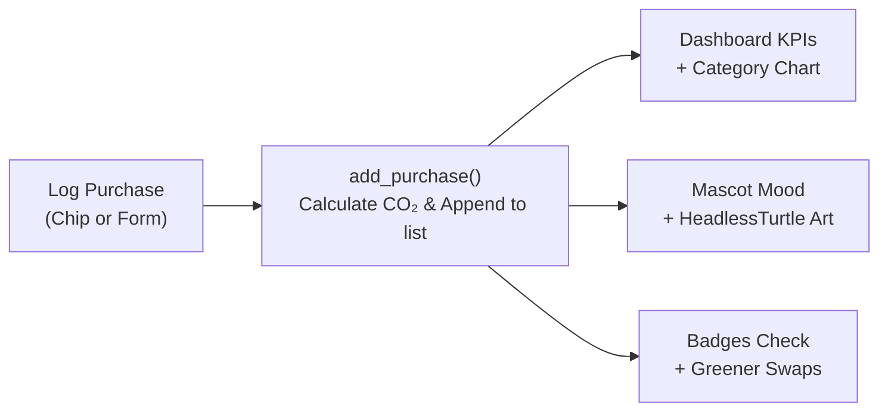

<div align="center">

# ShopImpact — Conscious Shopping Dashboard
### *Track what you buy, see its CO₂ impact live, and pick greener swaps*

[](https://idai102-1000544-parth-parvinbhai-gajera-sa.streamlit.app/)
[](https://www.python.org/)
[](https://streamlit.io/)
[]()
[]()

</div>

> **CRS:** Artificial Intelligence  
> **Course Name:** Python Programming (`IDAI 102`)  
> **Assignment Title:** Design and Deploy Interactive Python Applications for Social Good  
> **Scenario:** Scenario 1 — Build ShopImpact Conscious Shopping Dashboard using Python  
> **Student Name:** Parth Pravinbhai Gajera (Candidate Registration No: `1000544`)  
> **School Name:** Aspee Nutan Academy / WACP International  
> **Live Web App:** [https://idai102-1000544-parth-parvinbhai-gajera-sa.streamlit.app/](https://idai102-1000544-parth-parvinbhai-gajera-sa.streamlit.app/)  
> **GitHub Repository:** [https://github.com/parthibcpana/IDAI102-1000544-PARTH-PARVINBHAI-GAJERA-SA](https://github.com/parthibcpana/IDAI102-1000544-PARTH-PARVINBHAI-GAJERA-SA)  
> **Evaluator Access:** Shared with `ai.assignments@wacpinternational.org`

---

## Contents

1. [Project Overview](#project-overview)
2. [Stage 1: Understand the problem & plan your design](#stage-1-understand-the-problem--plan-your-design)
3. [Stage 2: Build your Python logic](#stage-2-build-your-python-logic)
4. [Stage 3: Build an interactive Streamlit cloud interface](#stage-3-build-an-interactive-streamlit-cloud-interface)
5. [Stage 4: Test & add creative features](#stage-4-test--add-creative-features)
6. [Stage 5: Deploy & document your project](#stage-5-deploy--document-your-project)

---

## Project Overview

**What the app does:**  
ShopImpact helps everyday shoppers see the carbon footprint behind what they buy. When you log a purchase (item name, product type, brand, price, and date), the app calculates its estimated CO₂ emissions right away, updates a live monthly dashboard, suggests realistic ethical alternatives, and rewards low-impact choices with badges and Turtle drawings.

**Key features:**
- Instant CO₂ calculator across 9 common shopping categories (plus a 30% credit for circular/thrift picks)
- Live dashboard with spend vs. CO₂ totals, category bar chart, date filter, and CSV export
- Practical greener brand alternatives shown right after each item is logged
- Unlockable milestone badges (*Eco Saver of the Month*, *Low Impact Shopper*, etc.) and reactive mascots
- Cloud-safe Turtle graphics rewards (Eco Leaf, Low Footprint, and Gold Badge Rosette)

**Intended Learning Outcomes & Ethics Reflection:**
- **Web App Design & Deployment:** Built and deployed an interactive Streamlit app (`app.py`) on Streamlit Cloud.
- **Core Python Constructs:** Used a Python `list` (`purchases`) to store all logged transactions along with dictionaries (`CATEGORIES`, `ETHICAL_ALTERNATIVES`, `ECO_MASCOTS`) and conditional logic for impact, badges, and reactions.
- **Python Libraries:** Combined `datetime` (purchase timestamps & filtering), `pandas` (category charts & CSV export), `Pillow` (in-memory Turtle art), and `streamlit` (live UI).
- **Plan, Test & Document:** Designed from a wireframe sketch, tested across 12–15 diverse sample purchases, and documented clearly.
- **Ethical Reflection:** Carbon calculators often make users feel guilty and quit. ShopImpact flips that by keeping all tracking private in session memory, celebrating small swaps, and showing positive CO₂ savings instead of shaming high purchases.

---

## Stage 1: Understand the problem & plan your design

### Who will use the app?
Young adults, students, and eco-conscious families who want to understand the environmental cost of their everyday purchases without reading complex reports.

### What pain points does it solve?
1. **Hidden footprint:** Most price tags don't show that a new pair of leather shoes or a smartphone carries tens of kilograms of embodied CO₂.
2. **No simple habit view:** Bank apps track money spent, not monthly carbon impact or emissions avoided by buying thrift or refurbished items.
3. **Guilt instead of guidance:** Many carbon trackers feel preachy instead of offering simple, practical swaps right when someone buys something.

### What emotions do you want to create?
**Awareness, empowerment, and fun** — never guilt! Small eco choices should feel rewarding, visible, and encouraging.

### Sketch of our vision
- **Design sketch:** [Sketch of our vision (/assets/sketch.png)](/assets/sketch.png)
- **Visual style:** Earthy tones (forest greens, warm sand/linen, and soft slate) paired with friendly animal mascots and clear spacing so numbers stand out immediately.

### Compulsory features planned
- Input fields for item description, product type, brand, price, and date
- Real-time CO₂ impact calculation
- Monthly dashboard summarizing total spend, CO₂ emissions, and carbon avoided
- Fun badges (*Eco Saver of the Month*, *Low Impact Shopper*, etc.) based on shopping choices
- Suggested list of greener alternatives for each product category
- Turtle graphic reward drawing a leaf, footprint, or eco badge on positive choices

### Optional features added
- Rotating **eco tips** and **motivational quotes** after logging purchases
- **Dark mode / light mode** toggle for comfortable high-contrast reading
- **Extra creative additions:** 60 FPS animated Biosphere terrarium, 5 reactive companion mascots, 1-click quick-purchase chips, Tree Offset Simulator, and an Undo button

---

## Stage 2: Build your Python logic

### Data structures
- **Purchases list (`st.session_state.purchases`):** A Python `list` storing every logged purchase as a dictionary with `item`, `category` (product type), `brand`, `price`, `date` (purchase date), `carbon_kg`, and `is_ethical`.
- **Dictionaries:**
  - `CATEGORIES`: maps all 9 product types to their CO₂ multiplier and short impact note.
  - `ETHICAL_ALTERNATIVES`: stores a `list` of greener brand alternatives and percentage savings per product type.
  - `ECO_MASCOTS`: holds the 5 companion characters and descriptions.

### Impact calculation
When a purchase is added via `add_purchase(...)`, `calculate_carbon(price, category, is_ethical)` multiplies the item price by the category's multiplier, applying a 30% reduction if the purchase is marked ethical/circular:

$$\text{Emissions (kg CO}_2\text{e)} = \text{price} \times \text{multiplier} \times (0.70 \text{ if ethical else } 1.0)$$

Carbon saved is measured against a standard retail average (`0.45 kg CO₂e / $`), then translated into car miles, phone charges, and tree-months via `get_equivalency()`.

| Product Type | Multiplier (kg / $) | Impact Level |
| :--- | :---: | :--- |
| Second-Hand / Thrift | `0.05` | Minimal |
| Zero-Waste Reusables | `0.07` | Minimal |
| Local / Organic Food | `0.08` | Low |
| Refurbished Tech | `0.11` | Low |
| Packaged Groceries | `0.38` | Moderate |
| Fast Fashion Apparel | `0.42` | High |
| Home & Plastics | `0.46` | High |
| Consumer Electronics | `0.55` | High |
| Footwear & Leather | `0.65` | Very High |

### Badges & messages
`evaluate_badges(purchases)` scans the purchases list and updates 5 badges live:
- 🌱 **Seed Starter:** Log 1+ item
- 🍃 **Low Impact Shopper:** Keep average intensity `≤ 0.25 kg/$` (min 2 items)
- ♻️ **Conscious Pioneer:** Log 3+ ethical or circular purchases
- 🌟 **Eco Saver of the Month:** Avoid `≥ 10 kg CO₂` vs standard baseline
- 🏆 **Zero-Waste Hero:** Log 2+ thrift or zero-waste items

At the same time, `evaluate_feedback_for_item()` picks the mascot mood (`ecstatic`, `happy`, `mindful`, `worried`, or `alarmed`) and generates a tailored message via `get_mascot_reaction()`.

### Suggestions
Every time a purchase is logged, the dashboard checks `ETHICAL_ALTERNATIVES[category]` and displays greener brand cards (for example: *Back Market* or *Fairphone* after logging Electronics, or *Patagonia Worn Wear* / *Local Thrift* after Fast Fashion) with a 1-click **Adopt** button.

### Integration details
All logic sits cleanly in modular functions inside [`app.py`](app.py) and connects seamlessly with Python libraries:
- **`datetime`:** timestamps every entry (`date.today()`) and powers the *All Time / Year / Month* filter.
- **`pandas`:** builds the emissions-by-category bar chart and formats the transaction table for CSV export.
- **`Pillow` (`PIL.ImageDraw`):** powers the `HeadlessTurtle` class so Turtle drawings render reliably on Streamlit Cloud without desktop `tkinter` errors.
- **`streamlit`:** handles onboarding, session state (`purchases` list), interactive forms, chips, tabs, and live re-renders.



---

## Stage 3: Build an interactive Streamlit cloud interface

### Layout
- **Welcome screen:** Captures shopper name, mascot spirit, and monthly CO₂ goal before entering.
- **Dashboard screen:** Places quick-purchase chips and the custom log form near the top, live KPIs, category chart, and ledger table in the center, and badges, biosphere health, and Turtle drawings clearly alongside in the hero/navigation area.

### Interactivity
- 6 one-click **Quick-Log chips** (`Coffee`, `Organic Lunch`, `Thrifted Jacket`, `Refurb Tech`, `Fast Fashion`, `Leather Shoes`)
- Custom purchase form with category tips and an **ethical/circular checkbox**
- Interactive **Tree Offset Simulator** slider to test hypothetical spending before buying
- Timeline filter (*All Time / Year / Month*), **Undo Last Purchase**, guarded Reset, and CSV download

### Visual hierarchy
Large metric cards (`Total Spend`, `Carbon Footprint`, `Carbon Avoided`, `Trees to Offset`) keep the key monthly numbers prominent, separated from detailed ledger tables and recommendations below.

### Color palette
Built around earthy, calm eco tones: deep **Obsidian Emerald** dark mode by default (`#0c120e`) with soft forest greens (`#2d6a4f`, `#34d399`), plus a toggleable **Warm Linen** light mode (`#fcfbf9`) for high contrast in any setting.

### Screenshots

<div align="center">

<p><em>Welcome screen: choosing a shopper name, companion mascot, and monthly CO₂ budget.</em></p>
</div>

<div align="center">

<p><em>Main dashboard: animated Biosphere globe, reactive mascot, KPI cards, quick-purchase chips, charts, and ledger.</em></p>
</div>

---

## Stage 4: Test & add creative features

### Testing with 10–15 purchases
To test realistic usage end-to-end, I entered **12 mixed purchases** spanning expensive, cheap, eco, and non-eco items (plus tested adopting a greener swap as item 13 and reverting with Undo back to 12):

| Type of Item Tested | Sample Entries (12 Purchases Total) | Price Range | Outcome Observed |
| :--- | :--- | :---: | :--- |
| **Cheap Eco** | Fair-Trade Coffee, Glass Pantry Jar Pack, Bamboo Water Bottle | `$4.50 – $24` | Totals updated cleanly (`0.25 – 1.18 kg` CO₂); Pip turned ecstatic and Turtle drew Eco Badge / Leaf art. |
| **Mid-Range Eco** | Vintage Denim Jacket, Organic Produce Box, Thrifted Wool Coat | `$32 – $48` | Applied 30% circular discount; unlocked *Seed Starter*, *Conscious Pioneer*, and *Zero-Waste Hero*. |
| **Expensive Eco** | Refurbished Laptop (`Back Market`) | `$280` | Logged `21.56 kg` CO₂ vs `154 kg` new; boosted *Carbon Avoided* past `100 kg` and unlocked *Eco Saver*. |
| **Non-Eco (Cheap & Expensive)** | Plastic Storage Bins, Sweater, Weekly Snacks, Leather Shoes (`$130`), Smartphone (`$320`) | `$22 – $320` | Intensity rose from `0.07` to `0.33 kg/$`; Biosphere shifted to overload and *Low Impact Shopper* stayed locked (`> 0.25 kg/$`). |

**Verification checks:**
- Do totals update immediately? **Yes** (`$989.50` spend, `329.4 kg` CO₂, `115.8 kg` saved updated on every submission).
- Are badges awarded correctly? **Yes** (4 of 5 badges unlocked cleanly; *Low Impact Shopper* stayed locked when intensity exceeded `0.25 kg/$`).
- Does Turtle drawing appear at the right time? **Yes** (Eco Leaf, Low Footprint, and Rosette Badge rendered automatically on eco/low-CO₂ items and cleared on high-CO₂ or Undo).

### Proof of tests (Sample collage)

<div align="center">

<p><em>Proof of tests (3 samples): (1) Eco choice KPIs & Turtle Rosette art, (2) 12-purchase mix chart & ledger with Brand column, and (3) Wall of Badges unlocking dynamically (4/5 earned).</em></p>
</div>

### Feedback & refinements
During testing and peer/family walkthroughs, a few rough edges showed up and were fixed:
- **Cloud Turtle crash fix:** Standard Python `turtle` uses `tkinter`, which crashes on Linux cloud servers (`TclError: no display name`). Built a pure-Pillow `HeadlessTurtle` class so Leaf, Footprint, and Rosette drawings render safely in memory.
- **Faster logging:** Manually typing every coffee or thrift item felt slow, so I added the 6 1-click Quick-Log chips right above the form.
- **State cleanup on Undo & Brand visibility:** Updated `Undo Last Purchase` to also revert the mascot reaction/Turtle art when undoing an entry, and added the `Brand` column straight into the visible Transaction Ledger table.
- **Defensive key access:** Standardized `carbon_kg` and `is_ethical` dictionary lookups to prevent `KeyError` issues across demo states and dataframes.

### Creative features added
- **60 FPS Animated Biosphere Globe:** Pure SVG terrarium whose sky glow and tree health shift smoothly based on your monthly CO₂ budget usage.
- **5 Companion Mascots:** *Shelly 🐢*, *Pip 🦊*, *Barnaby 🦉*, *Bumble 🐝*, and *Bao 🐼*, each with 5 animated expressions.
- **Interactive Tree Offset Simulator:** Test hypothetical spending (`$5 – $500`) to see car miles, phone charges, and tree-months before buying.
- **Eco Tips & Quotes:** Rotating real-world tips and sustainability quotes paired with every log.

---

## Stage 5: Deploy & document your project

### Requirements & Repository
- `app.py` — Full ShopImpact Streamlit application
- `requirements.txt` — Minimal pinned packages (`streamlit`, `pandas`, `pillow`)
- `README.md` — Project design, logic, testing proof, and deployment guide
- `assets/` — Wireframe sketch (`/assets/sketch.png`) and application screenshots (`assets/screenshots/`)

### Deployment instructions

**Run locally:**
```bash
git clone https://github.com/parthibcpana/IDAI102-1000544-PARTH-PARVINBHAI-GAJERA-SA.git
cd IDAI102-1000544-PARTH-PARVINBHAI-GAJERA-SA
pip install -r requirements.txt
streamlit run app.py
```

**Deploy on Streamlit Community Cloud:**
1. Push `app.py`, `requirements.txt`, `README.md`, and `assets/` to GitHub.
2. Open [share.streamlit.io](https://share.streamlit.io/) and click **"Create app"** ("Deploy an app").
3. Connect GitHub and select `parthibcpana/IDAI102-1000544-PARTH-PARVINBHAI-GAJERA-SA` (`main` branch, `app.py`).
4. Click **Deploy** to publish the live web app.

### Live app link
**Deployed App:** [https://idai102-1000544-parth-parvinbhai-gajera-sa.streamlit.app/](https://idai102-1000544-parth-parvinbhai-gajera-sa.streamlit.app/)

---

**Author:** Parth Pravinbhai Gajera (Candidate Registration No: `1000544`)  
**Course:** Python Programming (`IDAI 102`) — Artificial Intelligence  
**School:** Aspee Nutan Academy / WACP International
