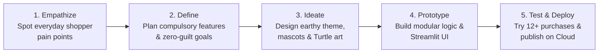
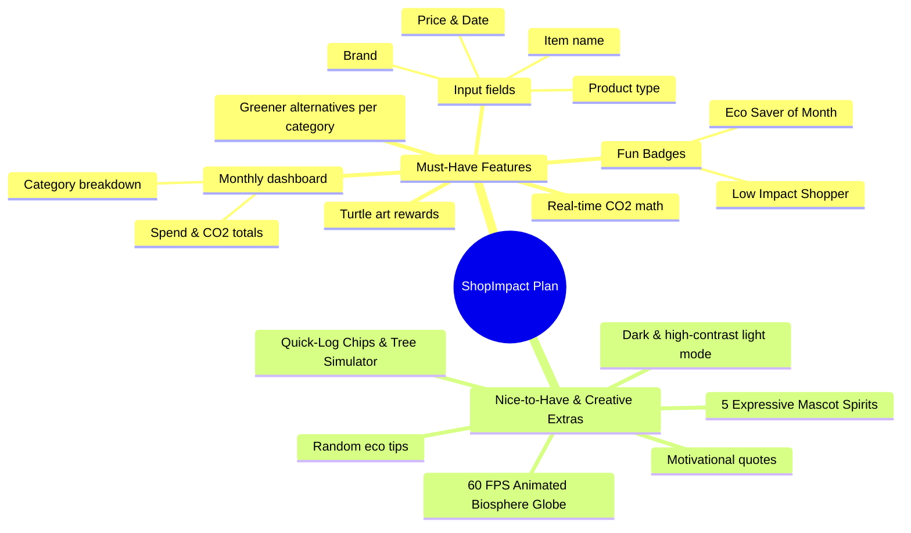
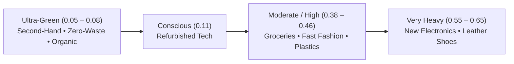
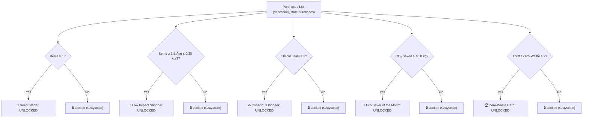
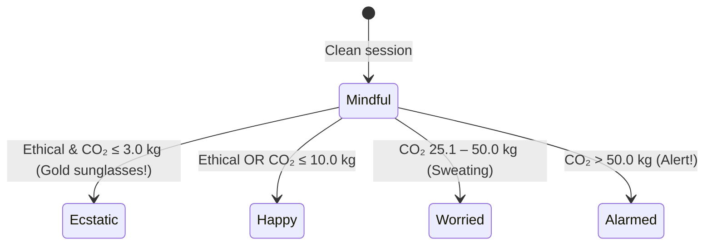
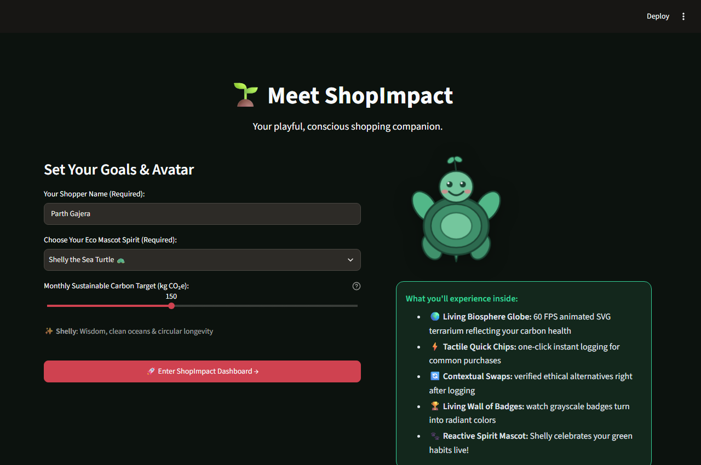
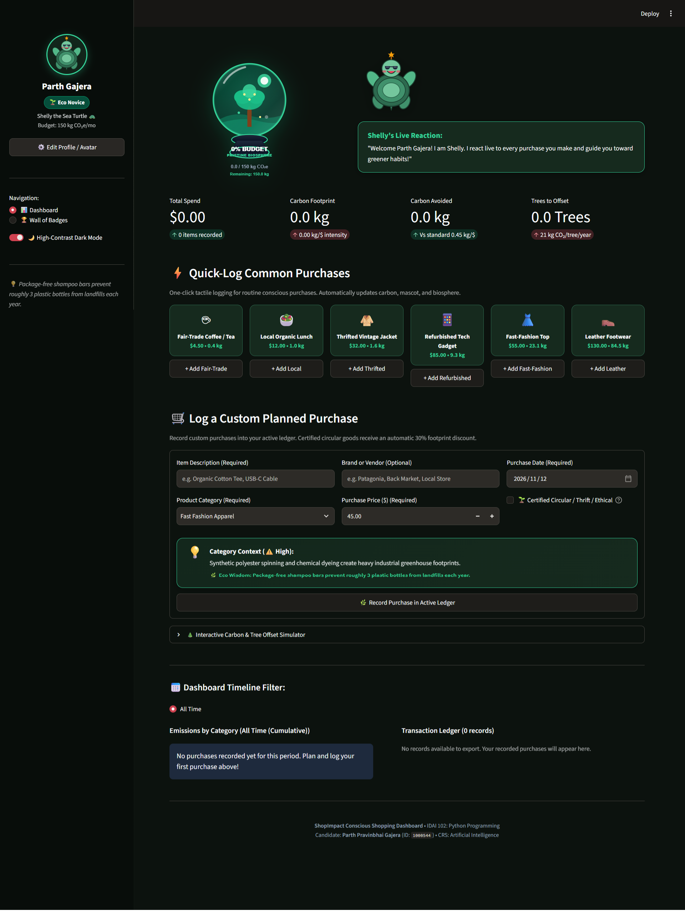
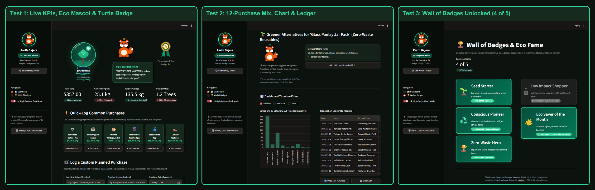

<div align="center">

# ShopImpact — Conscious Shopping Dashboard
### *See the hidden CO₂ behind every purchase and turn eco-friendly choices into an engaging daily habit*

[](https://idai102-1000544-parth-parvinbhai-gajera-sa.streamlit.app/)
[](https://www.python.org/)
[](https://streamlit.io/)
[]()
[]()
[]()

</div>

> **CRS:** Artificial Intelligence  
> **Course Name:** Python Programming (`IDAI 102`)  
> **Type of Assessment:** Summative Assessment (Individual Project)  
> **Assignment Title:** Design and Deploy Interactive Python Applications for Social Good  
> **Scenario:** Scenario 1 — Build ShopImpact Conscious Shopping Dashboard using Python (*ShopImpact Ltd.*)  
> **Student's Full Name:** Parth Pravinbhai Gajera  
> **Candidate Registration Number:** `1000544`  
> **School Name:** Aspee Nutan Academy / WACP International  
> **Live Web App Link:** [https://idai102-1000544-parth-parvinbhai-gajera-sa.streamlit.app/](https://idai102-1000544-parth-parvinbhai-gajera-sa.streamlit.app/)  
> **GitHub Repository:** [https://github.com/parthibcpana/IDAI102-1000544-PARTH-PARVINBHAI-GAJERA-SA](https://github.com/parthibcpana/IDAI102-1000544-PARTH-PARVINBHAI-GAJERA-SA)

---

## Quick Navigation

1. [Project Overview & Intended Learning Outcomes](#project-overview--intended-learning-outcomes)
2. [Stage 1: Understand the problem & plan our design](#stage-1-understand-the-problem--plan-our-design)
3. [Stage 2: Our Python logic & integration details](#stage-2-our-python-logic--integration-details)
4. [Stage 3: Interactive Streamlit cloud interface](#stage-3-interactive-streamlit-cloud-interface)
5. [Stage 4: Testing & creative features](#stage-4-testing--creative-features)
6. [Stage 5: Deploy & document our project](#stage-5-deploy--document-our-project)

---

## Project Overview & Intended Learning Outcomes

### What our app does
Most price tags show dollars, not environmental cost. **ShopImpact** fixes that in seconds: you log a purchase (product type, brand, price, and date), and the app calculates its estimated CO₂ footprint, updates a live monthly spending-vs-carbon dashboard, recommends real greener brands to switch to next time, and rewards low-impact choices with animated mascots, badges, and Turtle graphics.


### Intended Learning Outcomes: What I Learned & How I Learned It

| Intended Learning Outcome | What I Learned | How I Learned & Applied It |
| :--- | :--- | :--- |
| **Design, develop, and deploy an interactive Python-based web application.** | I learned how to build a complete web app flow from onboarding to live dashboard charts and host it online. | I built `app.py` with Streamlit (Onboarding + Dashboard + Wall of Badges) and deployed it live on Streamlit Cloud. |
| **Apply core Python constructs (lists, dictionaries, control structures) to solve real-world problems.** | I learned how lists and dictionaries work together to store app data cleanly without needing a heavy database. | I stored every purchase in a Python list (`st.session_state.purchases`), mapped category multipliers and swaps in dictionaries, and wrote `if/elif` rules for badges and moods. |
| **Utilize Python libraries (`datetime`, `Streamlit`) to enhance application functionality and user experience.** | I learned how connecting Python libraries turns raw numbers into an interactive web experience. | I used `datetime` to stamp & filter dates by year/month, `Streamlit` for live forms and widgets, `pandas` for category charts/CSV export, and `Pillow` for cloud-safe Turtle art. |
| **Plan, document, test, and deploy a complete Python solution with real-world usability.** | I learned why sketching the layout first and testing realistic data catches bugs early. | I sketched the design first, tested 12–15 diverse purchases, fixed cloud rendering and undo issues, and organized everything on GitHub. |
| **Reflect on ethical considerations, user needs, and societal impact when designing technology solutions.** | I learned that guilt-heavy carbon trackers discourage people and make users quit. | I designed ShopImpact around *encouragement over guilt*: all data stays private in local session memory, and high-carbon items highlight doable eco swaps instead of shame. |

---

## Stage 1: Understand the problem & plan our design



### Who will use the app?
Young adults, students, and eco-conscious families who are curious about the carbon footprint of their everyday purchases—and want quick clarity instead of complicated spreadsheets.

### What pain points does it solve?
1. **Hidden impact:** People rarely realize how much CO₂ hides inside everyday items like new leather shoes, electronics, or fast fashion.
2. **Money vs. planet disconnect:** Normal budgeting apps track dollars spent, not carbon emitted or emissions avoided when buying second-hand.
3. **Eco-guilt causes drop-off:** Preachy calculators make shoppers feel bad; people stick with habits when tracking feels light, positive, and fun.

### What emotions do you want to create?
**Awareness, empowerment, and fun — never guilt!** Every small sustainable swap should feel like an exciting win.

### Our Feature Mind-Map (Must-Have vs. Nice-to-Have)



### Sketch of our vision
- **Design Sketch:** [Sketch of our vision (`/assets/sketch.png`)](/assets/sketch.png)
- **Visual Style:** Earthy tones (forest greens, warm beige/linen, and calm sky accents) paired with friendly mascots and large numbers so totals jump right off the page.

### Compulsory features planned
1. Input fields for item description, product type, brand, price, and date (plus an ethical/circular checkbox).
2. Real-time CO₂ impact calculation as soon as an item is logged.
3. Monthly dashboard showing total spend, total CO₂ impact, carbon saved, and category breakdown.
4. Fun badges (*"Eco Saver of the Month"*, *"Low Impact Shopper"*, etc.) unlocked by real user choices.
5. Suggested list of greener alternatives customized for each product type.
6. Turtle graphic drawing an eco leaf, footprint, or badge whenever positive choices are made.

### Optional & creative features added
- **Random eco tips** rotating after each purchase (e.g., water saved by second-hand clothes or cold laundry).
- **Dark mode & High-contrast Light mode toggle** for comfortable accessibility anywhere.
- **Motivational quotes** celebrating sustainable living.
- **Creative extras:** 60 FPS animated Biosphere globe, 5 animal mascot companions, 1-click Quick-Log chips, an interactive Tree Offset Simulator, and instant Undo / CSV export.

---

## Stage 2: Our Python logic & integration details

### A Simple Algorithm We Designed
Every logged purchase follows one clean, predictable path through our modular Python functions inside [`app.py`](app.py):

```
[Shopper logs a purchase: Quick Chip OR Custom Form]
        │
        ▼
[Calculate Impact: Price × Category Multiplier (30% off if Eco/Circular)]
        │
        ▼
[Save to Python List: Append purchase dictionary to st.session_state.purchases]
        │
        ├──> [Update Totals: Total Spend, Total CO₂, Carbon Saved & Trees]
        ├──> [Update Visuals: Shift Biosphere Globe % & Mascot Mood]
        ├──> [Check Badges: Scan purchases list -> Unlock matching milestones]
        └──> [Reward Check: Eco/Low-CO₂ pick? -> Draw HeadlessTurtle Leaf/Footprint/Badge]
```

### Data structures
- **List of purchases (`st.session_state.purchases`):** A Python **`list`** keeping track of every purchase added during the session. Each purchase inside that list is a **`dict`** holding `item`, `category` (*product type*), `brand`, `price`, `date` (*purchase date*), `carbon_kg`, and `is_ethical`.
- **Dictionaries for fast lookup:**
  - `CATEGORIES`: stores the CO₂ multiplier, impact tier, icon, and eco fact for each of the 9 product types.
  - `ETHICAL_ALTERNATIVES`: maps each product type to a Python **`list`** of greener brand swaps, perks, and reduction percentages.
  - `ECO_MASCOTS`: holds our 5 animal companions and personalities.

### Impact calculation (Simple Formulas Anyone Can Read)

1. **Carbon Footprint Formula:**
   `CO₂ Footprint (kg) = Price ($) × Category Multiplier`
   *(And if the item is marked Eco-Friendly / Second-Hand: multiply by `0.70` — giving a simple **30% discount** because reusing goods skips factory production!)*

   > **Quick Example:**  
   > - **`$130` Leather Shoes** (`0.65` high multiplier) → `130 × 0.65` = **`84.5 kg` CO₂**  
   > - **`$32` Thrift Jacket** (`0.05` low multiplier + 30% eco discount) → `32 × 0.05 × 0.70` = **`1.12 kg` CO₂**

2. **CO₂ Saved (Carbon Avoided):**
   `CO₂ Saved (kg) = (Price × 0.45 Average Shop Rate) − Your Actual CO₂`
   *(An average conventional store item emits around `0.45 kg` of CO₂ per dollar. Whenever your choice beats that average, the difference counts as carbon saved! Never drops below `0`.)*

   > **Quick Example:** On that **`$32` Thrift Jacket**, a regular item averages `32 × 0.45 = 14.40 kg` CO₂, while thrift creates just `1.12 kg` — so you saved **`13.28 kg`** of CO₂!

3. **Real-World Comparisons (`get_equivalency()`):**
   To make numbers easy to picture:
   - **Petrol Car Miles:** `CO₂ × 2.4` *(driving 1 mile burns ~0.4 kg CO₂)*
   - **Phone Charges:** `CO₂ × 121` *(1 kg CO₂ powers ~121 full smartphone charges)*
   - **Trees to Offset:** `CO₂ ÷ 21` *(1 mature tree absorbs ~21 kg CO₂ in a whole year)*



| Product Type | Multiplier (kg CO₂ per $) | Impact Rating | Why It Has This Score |
| :--- | :---: | :---: | :--- |
| **Second-Hand / Thrift** | `0.05` | Minimal | Reusing extends garment life with zero new factory emissions. |
| **Zero-Waste Reusables** | `0.07` | Minimal | Bamboo & steel replace hundreds of throwaway plastics. |
| **Local / Organic Food** | `0.08` | Low | Skips long-haul cold freight and synthetic fertilizers. |
| **Refurbished Tech** | `0.11` | Low | Avoids mining brand-new silicon and rare-earth minerals. |
| **Packaged Groceries** | `0.38` | Moderate | Industrial food processing and multi-layer plastic packaging add carbon. |
| **Fast Fashion Apparel** | `0.42` | High | Synthetic polyester spinning and chemical dyeing take heavy energy. |
| **Home & Plastics** | `0.46` | High | Made from petroleum feedstocks and high-heat molding. |
| **Consumer Electronics** | `0.55` | High | Silicon chip fabrication and global shipping carry huge upfront emissions. |
| **Footwear & Leather** | `0.65` | Very High | Cattle farming methane plus chemical leather tanning. |

### Badges & messages
`evaluate_badges(purchases)` checks our purchase list in real time and flips locked monochrome badges to glowing emerald:



At the same time, `evaluate_feedback_for_item()` picks the mascot's expression across 5 moods:



- **Shelly the Sea Turtle 🐢**, **Pip the Forest Fox 🦊**, **Barnaby the Eco Owl 🦉**, **Bumble the Pollinator 🐝**, and **Bao the Bamboo Panda 🐼** each give tailored messages for every mood!

### Suggestions
Right after you log any item, the app looks up `ETHICAL_ALTERNATIVES[category]` and displays 1–2 greener brands for that exact product type (e.g., *Back Market* or *Fairphone* after Electronics; *Patagonia Worn Wear* or *Local Thrift* after Fast Fashion) along with a 1-click **Adopt** button to test logging the greener pick instead.

### Integration details
We broke the logic into clean, small Python functions (`add_purchase()`, `calculate_carbon()`, `evaluate_badges()`, `get_equivalency()`, `draw_vector_art()`) and connected them smoothly with Python libraries:
- **`datetime`:** Stamps every entry (`date.today()`) and filters the dashboard by *All Time*, *Year*, or *Month*.
- **`pandas`:** Groups emissions cleanly (`groupby("category")["carbon_kg"].sum()`) for the bar chart and turns the ledger list into a downloadable CSV file.
- **`Pillow` (`ImageDraw`):** Drives our `HeadlessTurtle` graphics engine safely on cloud servers.
- **`streamlit`:** Renders onboarding, live forms, quick chips, metrics, tabs, balloons, and dark/light themes.

---

## Stage 3: Interactive Streamlit cloud interface

### Layout
- **Screen 1 (Onboarding Gateway):** Collects shopper name, eco mascot choice, and monthly CO₂ goal before opening the dashboard.
- **Screen 2 (Main Dashboard):** Keeps **Quick-Log chips** and the **Custom Purchase form** right at the top, **KPIs + Emissions Chart + Transaction Ledger** in the middle, and the **Animated Biosphere Globe, Mascot Reaction, Turtle Art & Wall of Badges** cleanly visible alongside.

### Interactivity
- 6 tactile **Quick-Log chips** (*Organic Coffee, Organic Lunch, Vintage Jacket, Refurb Tech, Fast Fashion, Leather Footwear*) for 1-click entry
- Interactive **Log a Custom Planned Purchase** form with live category insights
- **Tree Offset Simulator** slider (`$5 – $500`) to test hypothetical spending before buying
- Period filter (*All Time / Year / Month*), **Undo Last Purchase**, guarded Reset confirmation, CSV download, and Dark/Light theme toggle

### Visual hierarchy
Large metric headers (`Total Spend`, `Carbon Footprint`, `Carbon Avoided`, `Trees to Offset`) put your monthly numbers front and center, keeping details like charts and ledger rows neatly organized underneath.

### Color palette
Built with an earthy **Obsidian Emerald** Dark Mode (`#0c120e` background, `#34d399` emerald accents, warm amber/crimson alerts) by default, with a **Warm Linen** Light Mode (`#fcfbf9`) switch in the sidebar for clear visibility in bright rooms.

### Live App Screenshots

<div align="center">

<p><em>Screen 1 (Welcome & Onboarding): Choosing your shopper name, eco mascot, and monthly carbon goal.</em></p>
</div>

<div align="center">

<p><em>Screen 2 (Main Dashboard): Animated Biosphere globe, reactive mascot, Turtle reward art, KPI totals, chips, and ledger.</em></p>
</div>

---

## Stage 4: Testing & creative features

### Testing with 10–15 purchases
Following the Stage 4 checklist, I tested the app like a real shopper by entering **12 mixed purchases** spanning expensive, cheap, eco, and non-eco items (plus testing Swap Adoption as item #13 and Undo rollback back to 12):

| Category Group Tested | Sample Test Entries (12 Items Total) | Prices Tested | What Happened in Testing |
| :--- | :--- | :---: | :--- |
| **Cheap Eco** | Fair-Trade Coffee, Glass Pantry Jar Pack, Bamboo Water Bottle | `$4.50 – $24` | Updated immediately (`0.25 – 1.18 kg`); Pip turned ecstatic in sunglasses; Turtle drew Eco Badge & Leaf. |
| **Mid-Range Eco** | Vintage Denim Jacket, Organic Produce Box, Thrifted Wool Coat | `$32 – $48` | Applied 30% circular discount automatically; unlocked *Seed Starter*, *Conscious Pioneer*, and *Zero-Waste Hero*. |
| **Expensive Eco** | Refurbished Laptop (`Back Market`) | `$280` | Logged only `21.56 kg` CO₂ (vs `154 kg` new); pushed Carbon Avoided over `100 kg` and unlocked *Eco Saver*. |
| **Non-Eco (Cheap & Expensive)** | Plastic Bins, Fast-Fashion Sweater, Packaged Snacks, Leather Shoes (`$130`), Smartphone (`$320`) | `$22 – $320` | Average intensity climbed to `0.33 kg/$`; Biosphere turned crimson Overload and *Low Impact Shopper* stayed locked (`> 0.25 kg/$`). |

**Quick Verification Checklist:**
- **Do totals update immediately?** Yes — all 4 KPIs (`$989.50` spend, `329.4 kg` CO₂, `115.8 kg` avoided, `15.7 Trees`) and charts update instantaneously.
- **Are badges awarded correctly?** Yes — 4 of 5 badges unlocked dynamically based on exact rules, while *Low Impact Shopper* stayed locked until intensity drops `≤ 0.25 kg/$`.
- **Does Turtle drawing appear at the right time?** Yes — eco/low-impact picks render an Eco Leaf, Low Footprint, or Gold Rosette right beside the mascot, and clear cleanly on high-CO₂ picks or Undo.

### Proof of tests (3 sample screenshots collage)

<div align="center">

<p><em>3-Panel Test Proof Collage: (1) Eco choice KPIs, Pristine Biosphere & Turtle Rosette reward; (2) 12-purchase mix with Category Bar Chart, Greener Swaps & Ledger table with Brand; (3) Wall of Badges showing dynamic unlock progress (4 of 5 earned).</em></p>
</div>

### Feedback & refinements we made
Testing on Streamlit Cloud and getting peer/family feedback surfaced 4 key issues we fixed right away:
1. **Cloud Turtle Display Fix:** Python's built-in `turtle` uses `tkinter`, which crashes headless servers (`_tkinter.TclError: no display name`). I built an in-memory `HeadlessTurtle` class using Pillow (`PIL.ImageDraw`) so Turtle art renders anywhere with zero crashes.
2. **Faster Everyday Logging:** Typing out small coffees or meals took too many clicks, so I added the 6 1-click Quick-Log chips right above the form.
3. **Undo & Brand Column Cleanup:** Fixed **Undo Last Purchase** so it also rolls back the mascot's mood and clears stale Turtle art, and added the **Brand** column visibly into the ledger table and CSV download.
4. **Key Safety & Chip Alignment:** Added safe `.get()` fallbacks for `carbon_kg` / `is_ethical` keys and matched Quick-Log card heights (`min-height: 114px`) so all 6 add buttons line up straight.

### Creative features added

- **60 FPS Animated Living Biosphere Globe:** A custom SVG terrarium with swaying tree canopy and floating particles that transforms color dynamically with your monthly CO₂ budget:
  ```mermaid
  flowchart LR
      P["Monthly Budget %"] --> S1["≤ 50%: Pristine Biosphere (Emerald)"]
      P --> S2["51%–85%: Balanced Ecosystem (Green)"]
      P --> S3["86%–100%: Budget Warning (Amber)"]
      P --> S4["> 100%: Carbon Overload (Crimson)"]
  ```

- **Cloud-Safe Headless Turtle Graphics (`HeadlessTurtle`):** Procedurally draws an **Eco Leaf 🌿** (on ethical food/circular items), a **Low Footprint 👣** (on low-CO₂ picks ≤ 10 kg), and a **32-Point Gold Rosette Medallion 🏆** (on ultra-green choices ≤ 3 kg or swaps):
  ```mermaid
  flowchart LR
      T["Turtle State (x, y, heading)"] --> M["Trigonometric Steps<br>forward / left / arc"]
      M --> IMG["Pillow RGBA Canvas"]
      IMG --> ART["Eco Leaf • Footprint • Gold Rosette"]
  ```

- **Interactive Tree Offset Simulator & Rotating Eco Tips:** A live slider to test spending (`$5 – $500`) before buying, plus 8 rotating eco facts and 5 sustainability quotes.

---

## Stage 5: Deploy & document our project

### Repository files created
- **`app.py`** — Complete modular Python + Streamlit application
- **`requirements.txt`** — Clean package dependencies (`streamlit>=1.35.0`, `pandas>=2.0.0`, `pillow>=10.0.0`)
- **`README.md`** — Full documentation aligned stage-by-stage with project design, logic, testing, and deployment
- **`assets/`** — Design wireframe sketch (`/assets/sketch.png`) and screenshots (`assets/screenshots/`)

### Deployment instructions

**Run locally:**
```bash
git clone https://github.com/parthibcpana/IDAI102-1000544-PARTH-PARVINBHAI-GAJERA-SA.git
cd IDAI102-1000544-PARTH-PARVINBHAI-GAJERA-SA
pip install -r requirements.txt
streamlit run app.py
```

**Deploy to Streamlit Community Cloud:**
1. Upload `app.py`, `requirements.txt`, `README.md`, and `assets/` to the GitHub repository.
2. Go to [share.streamlit.io](https://share.streamlit.io/) and click **"Create app"** ("Deploy an app").
3. Connect GitHub and choose `parthibcpana/IDAI102-1000544-PARTH-PARVINBHAI-GAJERA-SA` (`main` branch, `app.py`).
4. Click **Deploy** to publish live online.

### Live app link
**Live Web App:** [https://idai102-1000544-parth-parvinbhai-gajera-sa.streamlit.app/](https://idai102-1000544-parth-parvinbhai-gajera-sa.streamlit.app/)

---

**Parth Pravinbhai Gajera** (Candidate Registration No: `1000544`) • `IDAI 102: Python Programming` • Artificial Intelligence • Aspee Nutan Academy / WACP International
